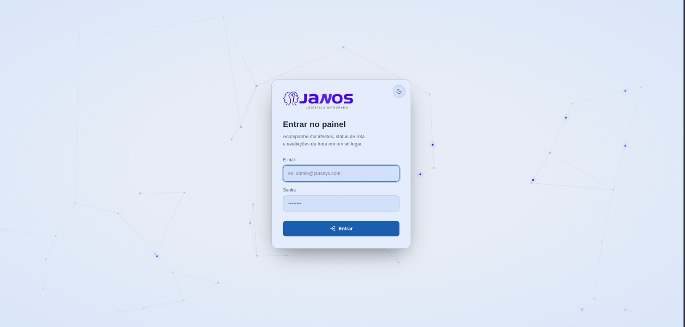
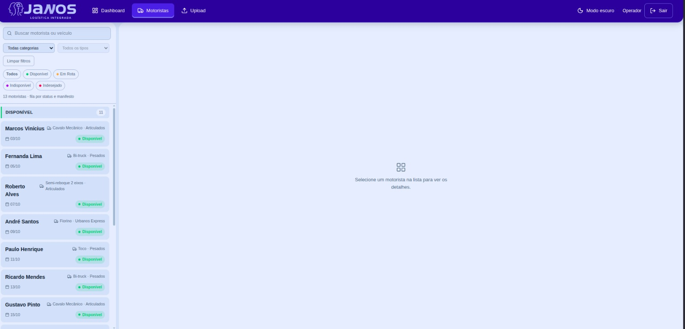
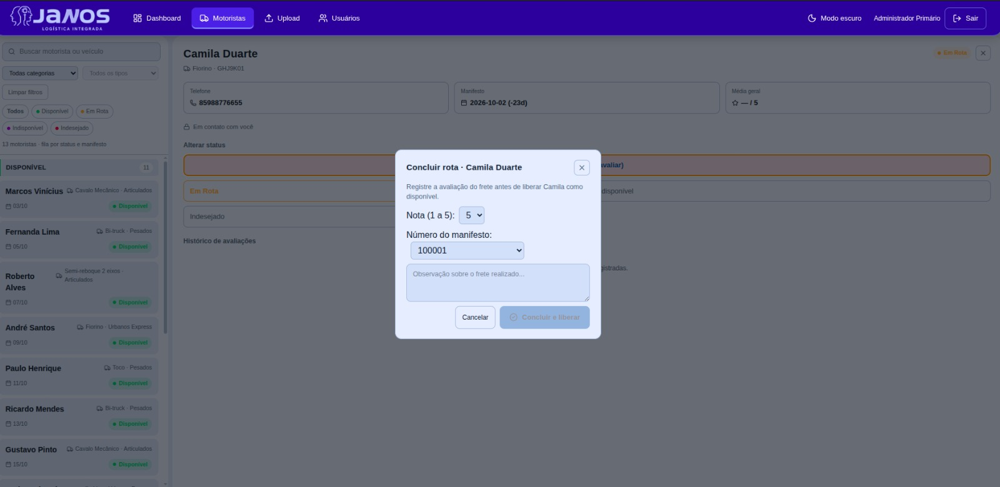
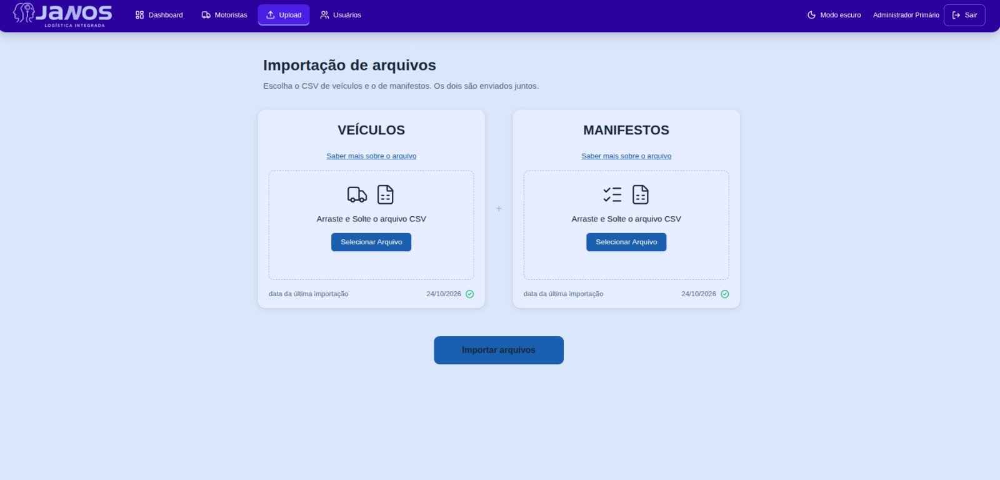
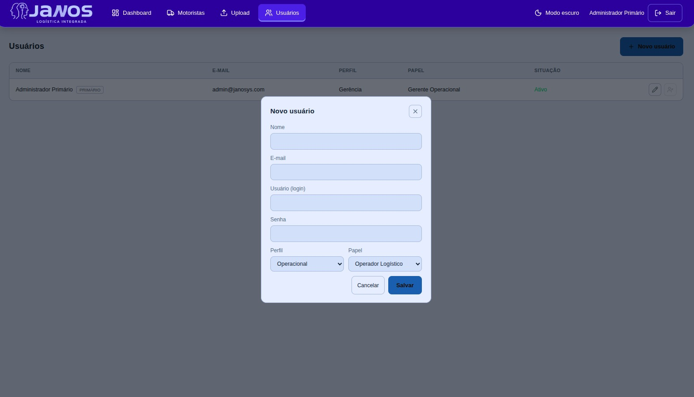

# 📌 MVP - API 3º sem. DSM 2026/2

# Documentação (Sprint II)

      

 📑 ÍNDICE 

  |<a href="#objetivo"> Objetivo</a> |
  <a href="#tasks"> Tasks da Sprint</a> |
  <a href="#pronto"> Definição de Pronto (Sprint II)</a> |
  <a href="#proximos"> Próximos Passos</a> |
  <a href="#anexos"> Anexos</a> |
  <a href="#referencias"> Referências</a> |

---

## 🎯 Objetivo (Sprint II — 07/09 a 23/09/2026) 
A Sprint I cobriu a base operacional: consulta de disponibilidade por tipo de veículo, cadastro por CSV, alteração de status e avaliação do frete.

A Sprint II torna essa base controlada, ordenada e alimentada com dados atualizados:

- Acesso controlado: login com token JWT, perfis Gerência e Operacional e gestão de usuários, com um usuário administrador primário que viabiliza o primeiro acesso;
- Fila por tempo de espera: lista de disponibilidade em 4 blocos por status (Disponível, Em Rota, Indisponível, Indesejado), com o manifesto mais antigo primeiro, e retorno automático de Indisponível para Disponível após 3 dias corridos;
- Escolha mais rápida: filtros por categoria e subcategoria de veículo, combinados com o filtro de status;
- Dados atualizados: upload mensal dos CSVs de Manifesto e de Veículos, com a data da última inserção de cada um;
- Rastreabilidade: número do manifesto como item obrigatório no encerramento do frete;
- Navegação: navbar com as abas Dashboard, Motoristas, Upload e Usuários.

Isso reforça a resposta ao principal problema do cliente: a falta de visibilidade centralizada sobre a disponibilidade real dos motoristas, que hoje gera contato duplicado (dois operadores ligando para o mesmo motorista ao mesmo tempo). A fila ordenada e os dados atualizados buscam reduzir esse contato duplicado, e não eliminá-lo, já que eliminar exigiria um mecanismo de reserva que não está no backlog.

---

## 🛠️ Tasks da Sprint 

| Rank | US · Título  | Estimativa (hr) |
| :--: | :---------- | :-------------: |
|  | **US5 · INSERIR NÚMERO DO MANIGESTO NO ENCERRAMENTO DO FRETE** |  |
| 1 | Guardar número do manifesto junto da avaliação do frete | 2 |
| 2 | Criar campo para inserção do número de manifesto no modal de avaliação | 2 |
|  | **US6 · SEPARAÇÃO DE MOTORISTA POR STATUS EM BLOCOS** |  |
| 3 | Criar blocos de status dos mostoristas | 3 |
| 4 | Criar Trigger de retorno de indisponível para disponível | 2 |
|  | **US7 · CRIAÇÃO DE SISTEMA DE LOGIN** |  |
| 5 | Criar sistema de login | 6 |
| 6 | Gerar tabelas de usuário e rota de login | 6 |
| 7 | Gerar autenticação das rotas | 6 |
| 8 | Integrar tela de login | 6 |
|  | **US8 · NAVBAR** |  |
| 9 | Gerar navbar fixa no topo | 7 |
| 10 | Ocultar abas de acordo com nível de acesso | 6 |
| 11 | Adaptar telas já existentes ao novo layout | 7 |
|  | **US9 · GESTÃO DE USUÁRIOS** |  |
| 12 | Criar rotas de CRUD | 6 |
| 13 | Gerar tela de gestão de usuários | 7 |
| 14 | Documentar rotas | 5 |
|  | **US10 · IMPORTAÇÃO DE MANIFESTO E VEÍCULOS (.csv)** |  |
| 15 | Completar tabelas de manifesto e salvar data de última importação | 8 |
| 16 | Gravar importação no banco | 7 |
| 17 | Gerar rota para aba de dados | 6 |
| 18 | Implentar conversor de arquivo para o formato UTF-8 | 5 |
|  | **US11 · FILTROS POR CATEGORIA E TIPO DE VEÍCULO** |  |
| 19 | Cadastrar categorias e subcategorias no banco | 8 |
| 20 | Gerar busca de motoristas por categoria, subcategoria e status | 7 |
| 21 | Gerar filtros de categoria na tela de motoristas | 6 |
---

## ✔️ Definição de Pronto (Sprint 2) 

- Código desenvolvido conforme os critérios de aceite do PRD da Sprint 2, revisado (pull request) e integrado (merge) na branch principal;
- Critérios de aceite (Dado/Quando/Então) de cada User Story validados pelo Product Owner;
- Testes manuais documentados com CSV válido, CSV malformado (linhas com erro não interrompem a importação das demais) e arquivo com acentuação ou codificação diferente de UTF-8;
- Teste da recusa de arquivo de manifesto no campo de Veículos;
- Testes de permissão por perfil: o Operacional não acessa a aba Usuários nem as rotas exclusivas da Gerência, e requisições sem token válido são recusadas;
- Fluxo ponta a ponta testado: login → upload dos CSVs → consulta da lista em blocos e filtros → alteração de status → encerramento do frete com nota, feedback e número do manifesto;
- Testes funcionais de usabilidade realizados com sucesso;
- Rotas de login e de gestão de usuários documentadas;
- Manual do Usuário e Manual da Aplicação atualizados;
- Documentação atualizada;
- Funcionalidade disponível em ambiente de teste/homologação;
- Vídeo de entrega anexado à documentação.

---

## 🚀 Próximos Passos 

**Sprint 3 (previsão 20/11/2026):** desenvolvimento do Dashboard; ranking de rentabilidade; ranking de utilização, exportação de rankings e demais itens do backlog

**Feira de Soluções:** 03/12/2026.

---

## 📂 Anexos / Evidências 

- Prints de tela / Protótipo    

- **TELA DE LOGIN**

- **TELA ABA MOTORISTAS**

- **TELA ABA MOTORISTAS · MODAL ENCERRAMENTO DE ROTA**

- **TELA ABA UPLOAD**

- **TELA ABA USUÁRIOS**

---

## 🔗 Referências 

- **README do repositório** — desafio, tecnologias, backlog completo, estratégia de branches, DoR/DoD geral do projeto.
- **PRD – Sprint 2** — critérios de aceite detalhados (Dado/Quando/Então), regras de negócio, requisitos não-funcionais, identidade visual, glossário, riscos e premissas.