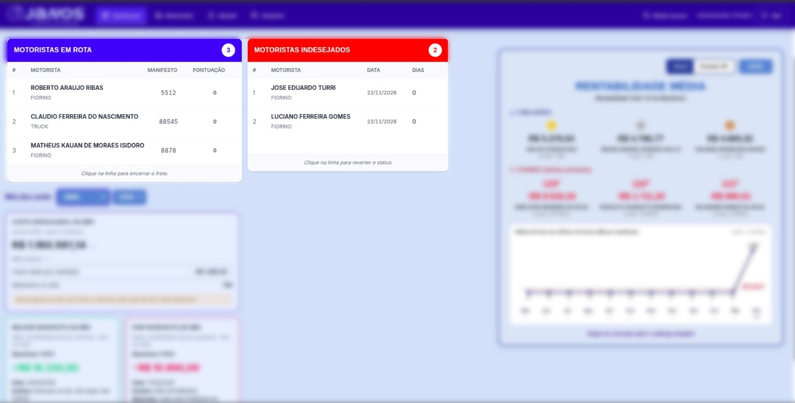
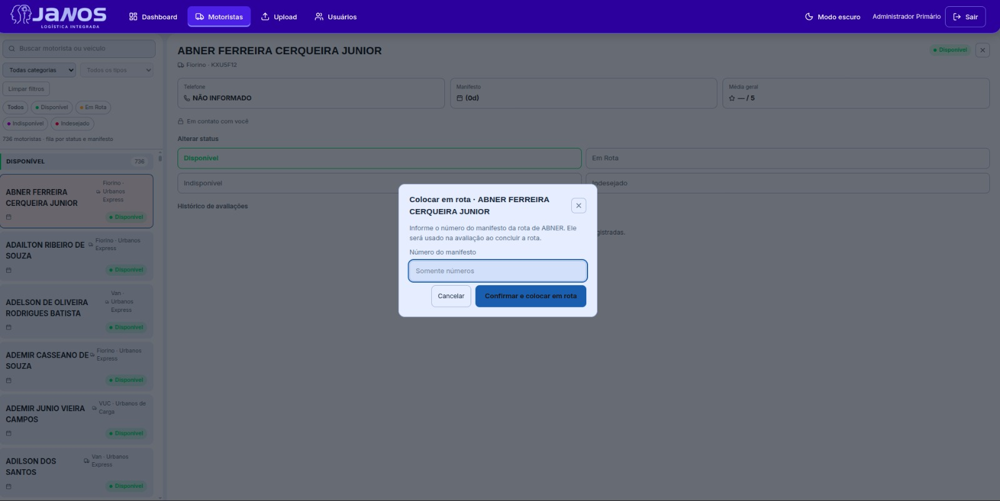
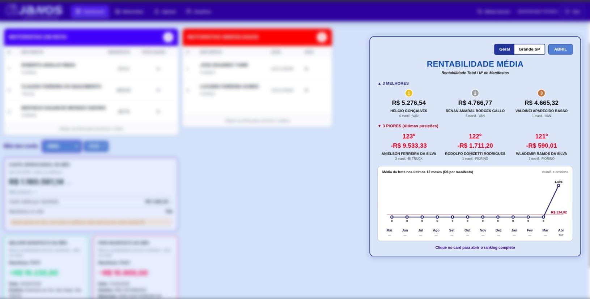
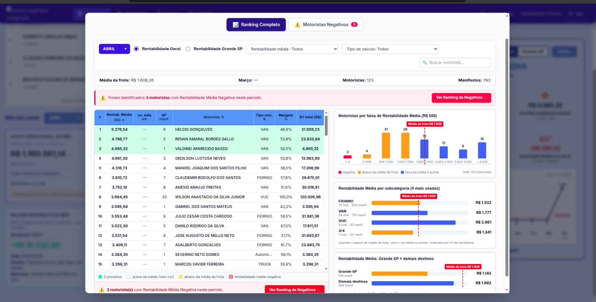
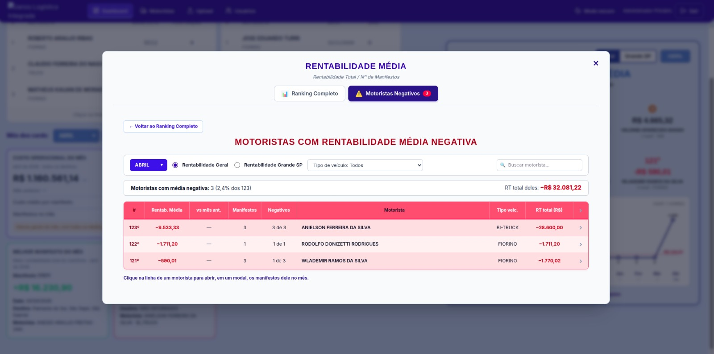
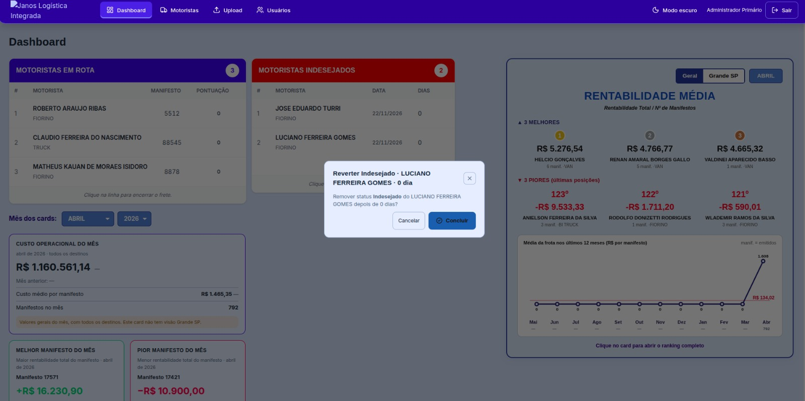
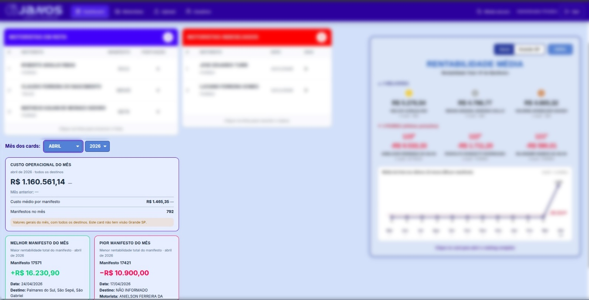
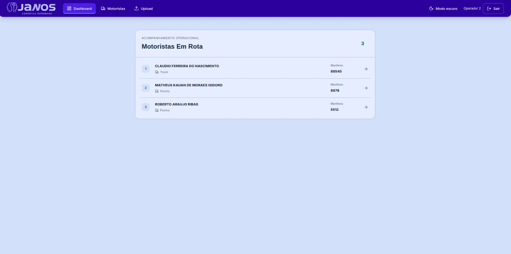

# 📌 MVP - API 3º sem. DSM 2026/2

# Documentação (Sprint III)

      

 📑 ÍNDICE 

  |<a href="#objetivo"> Objetivo</a> |
  <a href="#tasks"> Tasks da Sprint</a> |
  <a href="#pronto"> Definição de Pronto (Sprint III)</a> |
  <a href="#proximos"> Próximos Passos</a> |
  <a href="#anexos"> Anexos</a> |
  <a href="#referencias"> Referências</a> |

---

## 🎯 Objetivo (Sprint III — 03/11 a 20/11/2026) 

A Sprint II entregou a base controlada, ordenada e alimentada com dados atualizados: login com perfis, fila por tempo de espera, filtros por categoria e subcategoria, upload mensal dos CSVs e navbar.

A Sprint III transforma esses dados em informação para a decisão da gerência e para o acompanhamento da operação:

- Rastreabilidade: número do manifesto informado já no ato de colocar o motorista em rota, para acompanhar quem está em atuação;
- Decisão de gratificações: card e modal de Rentabilidade Média (3 melhores e 3 piores, variação contra o mês anterior, visões Geral e Grande SP, filtros e gráficos) e página dos motoristas com rentabilidade negativa, com os manifestos de cada um;
- Custo da operação: cards com o custo operacional do mês (total e custo médio por manifesto) e com o manifesto de melhor e o de pior rentabilidade;
- Acompanhamento: dashboard da gerência com os painéis "Em Rota" e "Indesejados", com encerramento do frete e reversão de "Indesejado" a partir dos painéis, e dashboard do operador com o painel "Em Rota".

Isso aproxima a plataforma do objetivo do cliente de acompanhar a rentabilidade e o desempenho dos motoristas agregados com mais assertividade, além de reforçar a visibilidade centralizada sobre quem está em rota.

---

## 🛠️ Tasks da Sprint 

(Estimativas em horas a preencher pelo devteam.)

| Rank | US · Título | Estimativa (hr) |
| :--: | :---------- | :-------------: |
|  | **US12 · NÚMERO DO MANIFESTO AO COLOCAR O MOTORISTA EM ROTA** |  |
| 1 | Digitar Nº de manifesto ao entrar em rota | 1.0 |
| 2 | Ajustar Encerramento de Rota | 1.0 |
| 3 | Gerar Modal para Inserção do nº de manifesto | 2.0 |
| 4 | Testar entradas de valor | 0.5 |
| 5 | Documentar US12 | 0.5 |
|  | **US13 · CARD DE RENTABILIDADE NO DASHBOARD** |  |
| 6 | Serviço de Cálculo de Rentabilidade | 1.5 |
| 7 | Definir Ranking | 1.0 |
| 8 | Criar Card de Rentabilidade | 2.0 |
| 9 | Integrar e Testar | 0.5 |
| 10 | Documentar US13 | 0.5 |
|  | **US14 · Modais de Ranking** |  |
| 11 | Gerar dados da Tabela e Resumo do Ranking | 1.0 |
| 12 | Gerar Dados dos Gráficos do Modal | 1.0 |
| 13 | Criar Modal do Ranking | 4.0 |
| 14 | Testar Implementação | 0.5 |
| 15 | Documentar US14 | 0.5 |
|  | **US15 · PÁGINA DE MOTORISTAS COM RENTABILIDADE NEGATIVA** |  |
| 16 | Gerar Lista de Motoristas com média Negativa | 1.0 |
| 17 | Gerar Lista decrescente do Pior ao Melhor Manifesto | 1.0 |
| 18 | Criar Página de Negativos | 2.5 |
| 19 | Testar Implementação | 0.5 |
| 20 | Documentar US15 | 0.5 |
|  | **US16 · DASHBOARD DA GERÊNCIA: EM ROTA E INDESEJADOS** |  |
| 21 | Lista ordenada por Avaliação dos motoristas a mais tempo "Em Rota" | 1.0 |
| 22 | Lista ordenada de Motoristas por tempo no status "Indesejado" | 1.0 |
| 23 | Criar os Paineis | 2.0 |
| 24 | Testar Implementação | 0.5 |
| 25 | Documentar US16 | 0.5 |
|  | **US17 · CARDS DE CUSTO OPERACIONAL E DE MELHOR E PIOR MANIFESTO** |  |
| 26 | Criar rotas dos Cards | 1.0 |
| 27 | Gerar telas dos Cards | 2.0 |
| 28 | Testar Implementação | 0.5 |
| 29 | Documentar US17 | 0.5 |
|  | **US18 · DASHBOARD DO OPERADOR: EM ROTA** |  |
| 30 | Liberar Visualização das métricas "Em Rota" | 1.0 |
| 31 | Criar Dashboard do Operacional | 2.0 |
| 32 | Abrir o encerramento do frete ao clicar no motorista | 1.0 |
| 33 | Testar Implementação | 0.5 |
| 34 | Documentar US18 | 0.5 |

---

## ✔️ Definição de Pronto (Sprint 3) 

- Código desenvolvido conforme os critérios de aceite do PRD da Sprint 3, revisado (pull request) e integrado (merge) na branch principal;
- Critérios de aceite (Dado/Quando/Então) de cada User Story validados pelo Product Owner;
- Cálculos conferidos com massa de dados e com CSV real do cliente: RT · Rentabildiade Total, RM · Rentabilidade Média, margem, CO · Custo Operacional, melhor e pior manifesto, variação contra o mês anterior, rentabilidade negativa, mês sem dados e mês sem mês anterior;
- Teste da rota Grande SP com variações de grafia do destino;
- Testes de permissão por perfil: o Operacional não acessa os cards, o modal e a página de rentabilidade, o painel Indesejados nem a avaliação média dos motoristas, e requisições sem token válido são recusadas;
- Fluxo ponta a ponta testado: login → upload dos CSVs → mudança de "Disponível" para "Em Rota" com o número do manifesto → painel "Em Rota" no Dashboard → encerramento do frete (nota e feedback) pelo painel → reversão de "Indesejado" para "Disponível" pela Gerência → rentabilidade no card, no modal e na página de negativos, com troca de mês e de visão;
- Modais conferidos: fechamento por X, Esc e clique fora, e sincronização de mês e visão entre o card e o modal;
- Testes funcionais de usabilidade realizados com sucesso;
- Rotas dos rankings, dos painéis do dashboard e da mudança de status com manifesto documentadas;
- Manual do Usuário atualizado;
- Manual da Aplicação atualizado;
- Documentação atualizada;
- Funcionalidade disponível em ambiente de teste/homologação;
- Vídeo de entrega anexado à documentação.

---

## 🚀 Próximos Passos 

**Feira de Soluções:** 03/12/2026.

---

## 📂 Anexos / Evidências 

- Prints de tela / Protótipo    

- **DASHBOARD DA GERÊNCIA · PAINÉIS EM ROTA E INDESEJADOS**

- **MODAL "COLOCAR MOTORISTA EM ROTA" (NÚMERO DO MANIFESTO)**

- **CARD DE RENTABILIDADE**

- **MODAL DO RANKING DE RENTABILIDADE**

- **PÁGINA DE MOTORISTAS COM RENTABILIDADE NEGATIVA E MODAL DOS MANIFESTOS**

- **MODAL DE REVERSÃO DE INDESEJADO**

- **CARDS DE CUSTO OPERACIONAL E DE MELHOR E PIOR MANIFESTO**

- **DASHBOARD DO OPERADOR**

---

## 🔗 Referências 

- **README do repositório** — desafio, tecnologias, backlog completo, estratégia de branches, DoR/DoD geral do projeto.
- **PRD – Sprint 3** — critérios de aceite detalhados (Dado/Quando/Então), regras de negócio, fórmulas, riscos e glossário.
- **Resumo das User Stories – Sprint 3** — consulta rápida para o devteam.

---
