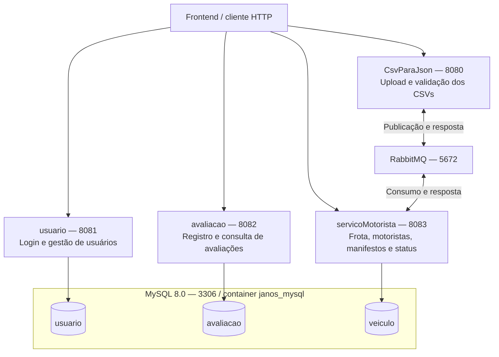

# Guia de Execução do Backend e Resumo da Arquitetura — FleetOps

> **Projeto:** Plataforma de Gestão e Gamificação de Motoristas Agregados
>
> **Parceiro Acadêmico:** Newelog | FATEC SJC - 3º DSM
>
> **Stack do código atual:** Java 21, Spring Boot 4.1.1, Spring Data JPA/Hibernate, Spring Security/JWT, MySQL 8.0, RabbitMQ 3.13 e Docker Compose.
>
> **Referência:** configurações e código revisados em 23/10/2026. Este guia descreve a execução dos quatro módulos do backend pelo Docker Compose e do frontend localmente.

---

## Sumário

1. [Pré-requisitos](#1-pré-requisitos)
2. [Como Rodar o Backend (Passo a Passo)](#2-como-rodar-o-backend-passo-a-passo)
3. [Como Validar que o Backend está Funcionando](#3-como-validar-que-o-backend-está-funcionando)
4. [Como Rodar o Frontend (Passo a Passo)](#4-como-rodar-o-frontend-passo-a-passo)
5. [Resumo da Arquitetura do Backend](#5-resumo-da-arquitetura-do-backend)
6. [Estrutura de Pastas e Pacotes](#6-estrutura-de-pastas-e-pacotes)

---

## 1. Pré-requisitos

### Backend pelo Docker Compose

- **Docker com suporte a containers Linux e ao comando `docker compose`.** No Windows/macOS, instale e inicie o [Docker Desktop](https://docs.docker.com/desktop/). No Linux, também é possível usar [Docker Engine](https://docs.docker.com/engine/install/) com o [plugin Compose](https://docs.docker.com/compose/install/). O daemon precisa estar ativo e acessível ao usuário.
- **Git**, para clonar os repositórios: [instruções oficiais de instalação](https://git-scm.com/book/en/v2/Getting-Started-Installing-Git).
- **Acesso à internet na primeira construção**, para baixar imagens e dependências Maven.
- **Portas disponíveis:** `8080` (CSV), `8081` (usuários), `8082` (avaliações), `8083` (motoristas), `3306` (MySQL) e `5672` (RabbitMQ).
- **Arquivo `.env` na pasta `Back-End` com `JWT_SECRET` preenchido.** A chave é compartilhada pelos quatro serviços; o Compose a repassa como `APP_SECURITY_JWT_SECRET`. A seção 2 mostra como gerá-la sem sobrescrever um arquivo existente.
- **Para os comandos Bash deste guia:** Linux/macOS ou Git Bash no Windows. No Windows, a geração de chave também possui uma alternativa em PowerShell. Os exemplos com `curl` usam sintaxe Bash; não devem ser colados sem adaptação no CMD ou no Windows PowerShell.
- **OpenSSL no Linux/macOS/Git Bash**, somente para a geração automática da chave. Confirme com `openssl version`; instale pelo gerenciador de pacotes do sistema caso não esteja disponível. A alternativa PowerShell não exige OpenSSL.
- **Opcional:** Postman, Insomnia ou `curl` para testar login e endpoints.

Os Dockerfiles compilam com Maven 3.9/JDK 21 e executam com JRE 21. Para esse modo, não é necessário instalar Java, Maven, MySQL ou RabbitMQ diretamente na máquina.

No Linux, se `docker info` indicar falta de permissão, configure o acesso conforme as [instruções oficiais de pós-instalação](https://docs.docker.com/engine/install/linux-postinstall/), ou use `sudo` de forma consistente nos comandos Docker. `systemctl start docker` inicia o daemon, mas não concede acesso ao usuário. No Docker Desktop, utilize o ambiente de containers Linux.

### Frontend local

- **Node.js 24 LTS atualizado com npm**, disponível na [página oficial de instalação](https://nodejs.org/pt-br/download). O frontend usa Vite 8; o lockfile inclui ferramentas com exigências adicionais, como `lint-staged` com Node `>=22.22.1`. Node 18 ou versões antigas de Node 20 não atendem ao conjunto atual.
- **Git, acesso ao registro npm e um navegador moderno.** `Node.js`/npm são necessários para a seção 4, não para iniciar o backend pelo Compose.

### Desenvolvimento do backend fora dos containers

Para compilar ou depurar os módulos localmente, use **JDK 21** e Maven ou o wrapper de cada módulo, atualmente configurado para Maven 3.9.16. Esse modo exige configurar separadamente MySQL, RabbitMQ, portas e `APP_SECURITY_JWT_SECRET`; o passo a passo principal abaixo utiliza Docker Compose.

O `.env` é lido pelo Compose; não é automaticamente carregado pela IDE ou pelo Maven. Não existe um único `BackendApplication` nem Maven Wrapper na raiz do agregador. As quatro aplicações precisam de portas distintas quando iniciadas fora do Compose.

---

## 2. Como Rodar o Backend (Passo a Passo)

### Passo 1: Clonar o repositório e acessar a pasta

Abra um terminal na pasta onde deseja manter os repositórios:

```bash
git --version
git clone https://github.com/Janosys-Log/Back-End.git
cd Back-End
```

Se já possui o checkout, acesse sua pasta `Back-End` em vez de clonar novamente. Confirme a presença de `docker-compose.yml`, `pom.xml`, `.envExample`, `infra-database/init.sql` e dos quatro módulos. O submódulo `Documentos` não é necessário para executar os serviços; caso queira baixá-lo, execute `git submodule update --init --recursive` na raiz do backend.

### Passo 2: Configurar a chave JWT no `.env`

Execute **uma** das alternativas abaixo dentro de `Back-End`. Elas preservam um `.env` existente; nesse caso, confira no editor se `JWT_SECRET` já está preenchido corretamente.

**Linux/macOS ou Git Bash, com OpenSSL disponível:**

```bash
if [ -e .env ]; then
  printf '%s\n' '.env existente preservado; confira JWT_SECRET no editor.'
else
  (
    umask 077
    set -C
    jwt_key=$(openssl rand -base64 32) &&
      printf 'JWT_SECRET=%s\n' "$jwt_key" > .env
  )
fi
```

**Windows PowerShell, sem dependência de OpenSSL:**

```powershell
if (Test-Path .env) {
    Write-Output '.env existente preservado; confira JWT_SECRET no editor.'
} else {
    $jwtBytes = New-Object byte[] 32
    $jwtGenerator = [System.Security.Cryptography.RandomNumberGenerator]::Create()
    try {
        $jwtGenerator.GetBytes($jwtBytes)
        $jwtKey = [Convert]::ToBase64String($jwtBytes)
        Set-Content -Path .env -Value "JWT_SECRET=$jwtKey" -Encoding ASCII
    } finally {
        $jwtGenerator.Dispose()
    }
}
```

Os exemplos geram 32 bytes aleatórios e gravam sua representação Base64 em uma linha `JWT_SECRET=...`. Os serviços usam o texto dessa variável como chave HMAC; a implementação exige pelo menos 32 bytes de texto UTF-8. Não gere uma chave diferente para cada serviço.

Se preferir preparar o arquivo pelo modelo `.envExample`, faça a cópia somente quando `.env` não existir e substitua o valor de exemplo por uma chave válida. Uma variável `JWT_SECRET` já exportada no terminal tem precedência sobre o arquivo `--env-file`; confira o ambiente se a chave efetiva não for a esperada. [Referência do Compose](https://docs.docker.com/compose/how-tos/environment-variables/variable-interpolation/).

### Passo 3: Verificar o Docker e validar o Compose

```bash
docker info
docker compose version
docker compose --env-file .env config --quiet
```

`docker info` deve conseguir acessar o daemon. `config --quiet` valida a configuração sem iniciar containers nem imprimir o arquivo resolvido com suas variáveis. Corrija erros e avisos, inclusive sobre `JWT_SECRET` ausente, antes de prosseguir; esse comando não testa a autenticação JWT da aplicação.

No Linux com serviço gerenciado por systemd, inicie o daemon se necessário:

```bash
sudo systemctl start docker
```

No Docker Desktop, inicie o aplicativo e confirme que está usando containers Linux. Se uma das portas listadas nos pré-requisitos já estiver ocupada, libere-a antes de iniciar este Compose. Alterar portas exige conferir também as URLs usadas pelo frontend.

### Passo 4: Construir e iniciar os serviços

Na pasta `Back-End`:

```bash
docker compose --env-file .env up -d --build
```

O comando constrói os quatro serviços Java e inicia também MySQL e RabbitMQ. Os Dockerfiles usam `-DskipTests`; a conclusão da construção não significa que os testes automatizados foram executados. Para esse modo de execução, não inicie outra cópia das aplicações na IDE nas mesmas portas.

| Serviço no Compose  | Container           | Porta local | Banco utilizado                              |
| :------------------ | :------------------ | :---------: | :------------------------------------------- |
| `servico-csvjson`   | `servico_csvjson`   |   `8080`    | Sem banco próprio; envia dados por RabbitMQ. |
| `servico-usuario`   | `servico_usuario`   |   `8081`    | `usuario`                                    |
| `servico-avaliacao` | `servico_avaliacao` |   `8082`    | `avaliacao`                                  |
| `service-motorista` | `servico_motorista` |   `8083`    | `veiculo`                                    |
| `mysql-db`          | `janos_mysql`       |   `3306`    | Hospeda os bancos dos serviços.              |
| `rabbitmq`          | `rabbit_janosys`    |   `5672`    | Não se aplica.                               |

O Compose monta `infra-database/init.sql` para a primeira inicialização do MySQL e mantém os dados em `mysql_data`. O script cria `usuario`, `avaliacao`, `veiculo` e também `manifesto`; esse último banco não é usado pelas conexões atuais. A entidade `Manifesto` é persistida no banco `veiculo`, pelo serviço de motoristas. Os serviços JPA usam `spring.jpa.hibernate.ddl-auto=update`.

O script de inicialização não é reaplicado automaticamente a um volume MySQL já populado. Se estiver reutilizando dados antigos, confira se os bancos configurados existem e se as credenciais do volume correspondem às do Compose. Não é necessário instalar um MySQL adicional no host.

### Passo 5: Acompanhar a inicialização

```bash
docker compose ps
docker compose logs --tail=100 mysql-db rabbitmq service-motorista
docker compose logs --tail=100 servico-usuario servico-avaliacao servico-csvjson
```

A primeira construção pode demorar devido aos downloads e à compilação. MySQL, RabbitMQ e motoristas possuem healthchecks no Compose. CSV depende de RabbitMQ e motoristas saudáveis; usuários e avaliações dependem de MySQL e RabbitMQ saudáveis. Usuários, avaliações e CSV não possuem healthcheck próprio declarado; o estado `running` desses containers não substitui uma verificação HTTP.

Depois, valide o login e as consultas da seção 3. Para parar a execução mantendo os dados, execute `docker compose stop` na pasta `Back-End`.

---

## 3. Como Validar que o Backend está Funcionando

### Estado dos containers e logs

```bash
docker compose ps
docker compose logs --tail=100 servico-usuario servico-avaliacao service-motorista servico-csvjson
```

Verifique o início de cada aplicação na porta correspondente e a ausência de erros de conexão com MySQL ou RabbitMQ. Usuários, avaliações e CSV não possuem healthcheck próprio declarado no Compose; confirme também as respostas HTTP antes de considerá-los disponíveis.

O projeto possui quatro classes principais: `UsuarioApplication`, `AvaliacaoApplication`, `MotoristaApplication` e `CsvParaJsonApplication`.

Os exemplos `curl` desta seção usam Bash (Linux/macOS/Git Bash). No Windows PowerShell, use Postman/Insomnia ou adapte os comandos para `Invoke-RestMethod`; `curl` pode ser um alias e as continuações com `\` são específicas do Bash.

### Healthcheck do serviço de motoristas

```bash
curl --include 'http://localhost:8083/actuator/health'
```

A resposta esperada em condição saudável é HTTP `200` com `status: UP`. Esse endpoint é público e também é usado pelo healthcheck do Compose.

### Autenticação e chamada de uma rota protegida

O serviço de usuários cria um usuário primário quando o e-mail configurado ainda não existe. Os valores padrão do seeder são `admin@janosys.com` e senha `Admin@123456`; use as credenciais efetivas do ambiente se já tiverem sido alteradas. O login usa e-mail, não o campo `login` do cadastro.

```bash
curl --include --request POST 'http://localhost:8081/api/auth/login' \
  --header 'Content-Type: application/json' \
  --data '{"email":"admin@janosys.com","senha":"Admin@123456"}'
```

Em caso de sucesso, a resposta contém `token` e `tipo: Bearer`. Copie o token para testar a consulta:

```bash
curl --include 'http://localhost:8083/api/motoristas/disponiveis' \
  --header 'Authorization: Bearer <token recebido no login>' \
  --header 'Accept: application/json'
```

Uma resposta `200` com `[]` indica que essa consulta funcionou e não encontrou motoristas disponíveis; não comprova o funcionamento de todos os serviços ou da importação. Abrir essa rota no navegador sem enviar o token pode retornar `401`, mesmo com a aplicação em funcionamento.

Para conferir também os serviços de usuários e avaliações, use o token de gerência obtido no login:

```bash
curl --include 'http://localhost:8081/api/usuarios' \
  --header 'Authorization: Bearer <token recebido no login>'
curl --include 'http://localhost:8082/api/avaliacoes' \
  --header 'Authorization: Bearer <token recebido no login>'
```

Esses GETs devem retornar `200` com arrays JSON quando os respectivos serviços e bancos estiverem disponíveis. `401` indica falha de autenticação; `403` em usuários indica perfil sem permissão de gerência.

As rotas de usuários usam a porta `8081` e exigem perfil `GERENCIA`; avaliações usam `8082`; motoristas, veículos, agregados e manifestos usam `8083`; o upload `POST /csv` usa `8080`. O CSV recebe os arquivos multipart `csvVeiculo` e `csvManifesto` e precisa do consumidor RabbitMQ disponível. Consulte os contratos e exemplos no [Dicionário de Dados e Modelos JSON](DicionarioDadosBDComExemplos.md).

---

## 4. Como Rodar o Frontend (Passo a Passo)

### Passo 1: Clonar o frontend em uma pasta separada

Abra **outro terminal na pasta que contém `Back-End`**, para manter os repositórios como irmãos:

```bash
git clone https://github.com/Janosys-Log/Front-End.git
cd Front-End
```

Se o novo terminal abriu dentro de `Back-End`, use `cd ..` antes do clone. Se já possui o frontend, apenas acesse sua pasta. Mantenha os serviços do backend em execução.

### Passo 2: Conferir Node.js e npm

```bash
node --version
npm --version
```

Use Node.js 24 LTS atualizado. Se o comando não for encontrado ou indicar uma versão incompatível, instale/atualize Node pelo link dos pré-requisitos e reabra o terminal. As versões verificadas no projeto estão em `package.json` e `package-lock.json`.

### Passo 3: Instalar as dependências do lockfile

Dentro de `Front-End`:

```bash
npm ci
```

Como o repositório contém `package-lock.json`, `npm ci` instala a árvore registrada sem reescrever o lockfile; ele recria `node_modules`, se já existir. Se `package.json` e lockfile estiverem incompatíveis, o comando falha: confira o checkout antes de prosseguir. O script `prepare` do projeto executa Husky, portanto mantenha o contexto de repositório Git. [Referência do npm](https://docs.npmjs.com/cli/v11/commands/npm-ci/).

### Passo 4: Conferir as URLs de integração

Os valores locais atuais são:

| Integração              | URL / configuração                                                                   |
| :---------------------- | :----------------------------------------------------------------------------------- |
| Autenticação            | `http://localhost:8081/api/auth`, sobrescrito por `VITE_AUTH_API_URL`.               |
| Usuários                | `http://localhost:8081/api/usuarios`, sobrescrito por `VITE_USUARIOS_API_URL`.       |
| Motoristas e manifestos | `http://localhost:8083`, definido diretamente nos arquivos de integração.            |
| Upload CSV              | `http://localhost:8080/csv`, definido diretamente em `importacao.service.ts`.        |
| Avaliações no backend   | `http://localhost:8082/api/avaliacoes`; há divergências no cliente descritas abaixo. |

### Passo 5: Iniciar o servidor de desenvolvimento

```bash
npm run dev
```

Mantenha o terminal aberto e acesse a URL `Local` exibida pelo Vite. A porta do frontend é diferente das portas das APIs; use o endereço efetivamente exibido. Faça login com as credenciais válidas do serviço de usuários. Para encerrar o servidor de desenvolvimento, use `Ctrl+C` nesse terminal.

---

## 5. Resumo da Arquitetura do Backend

O backend já está dividido em **quatro serviços Spring Boot**, construídos por um projeto Maven agregador. Os serviços mantêm suas próprias camadas e configurações de segurança. MySQL e RabbitMQ são compartilhados como infraestrutura no Compose; os dados JPA são separados em bancos por serviço.



### Responsabilidade de cada serviço

- **`usuario`:** login por e-mail, emissão de JWT e gestão de usuários. Usa `UsuarioCreateRequest`, `UsuarioUpdateRequest` e `UsuarioResponse`; armazena senhas com BCrypt. `UsuarioPrimarioSeeder` cria a conta inicial quando necessário.
- **`servicoMotorista`:** consultas de agregados, veículos, motoristas e manifestos; alteração de status em `PUT /api/status/updateStatus`. Consome os dados CSV via `OuvinteCsvParaJson` e os persiste no banco `veiculo`.
- **`avaliacao`:** registra e consulta avaliações de frete com notas de 1 a 5. Armazena `motoristaId` e `numeroManifesto` como valores escalares, sem relacionamento JPA entre bancos.
- **`CsvParaJson`:** recebe os dois arquivos em `POST /csv`, converte e valida as linhas, envia os resultados pelo RabbitMQ e espera a resposta do consumidor. Não possui entidades JPA nem conexão de banco própria configurada.

### Papel dos pacotes

- **`controller`:** endpoints REST e conversão dos contratos HTTP em chamadas ao serviço ou repositório; `AgregadoController` consulta seu repositório diretamente.
- **`service`:** regras de negócio, validação, importação e atualização de dados. O código atual não recalcula automaticamente a nota média ou o contador de viagens do motorista ao receber avaliações/manifestos.
- **`repository`:** interfaces Spring Data JPA nos módulos que persistem dados.
- **`domain`:** entidades JPA e enums de domínio. Os relacionamentos existentes no serviço de motoristas incluem associações `EAGER`; não há uma política geral de `LAZY` no modelo atual.
- **`dto`:** contratos de entrada e saída. Os nomes JSON podem diferir dos nomes das propriedades das entidades.
- **`config` e `security`:** CORS, segurança stateless/JWT, mensageria e outras configurações de cada módulo.
- **`ouvinte`:** consumidores RabbitMQ do serviço de motoristas; **`enums`**: classificações utilizadas no parser CSV; **`exception`/`exceptions`**: exceções e handlers; **`seeder`**: criação do usuário primário.

A atualização de status retorna `204`; avaliações não atualizam automaticamente a média em outro serviço. O upload é processado em duas etapas, veículos e depois manifestos, sem transação única entre os dois arquivos. Os erros tratados pelo módulo CSV retornam um objeto de erro com HTTP `200`; o cliente precisa verificar também o corpo.

---

## 6. Estrutura de Pastas e Pacotes

```text
Back-End/
├── .envExample                           # Modelo da variável JWT_SECRET
├── .env                                  # Configuração local usada pelo Compose
├── docker-compose.yml                    # Quatro serviços Java, MySQL e RabbitMQ
├── pom.xml                               # Agregador Maven: Java 21 / Spring Boot 4.1.1
├── infra-database/
│   └── init.sql                          # Inicialização dos bancos no volume novo
├── usuario/
│   ├── Dockerfile
│   ├── pom.xml
│   ├── mvnw / mvnw.cmd                    # Wrapper do módulo
│   └── src/main/
│       ├── java/com/fleetops/usuario/
│       │   ├── UsuarioApplication.java
│       │   ├── config/
│       │   ├── controller/
│       │   ├── domain/
│       │   ├── dto/
│       │   ├── exception/
│       │   ├── repository/
│       │   ├── security/
│       │   ├── seeder/
│       │   └── service/
│       └── resources/application.properties
├── servicoMotorista/
│   ├── Dockerfile
│   ├── pom.xml
│   ├── mvnw / mvnw.cmd
│   └── src/main/
│       ├── java/com/fleetops/motorista/
│       │   ├── MotoristaApplication.java
│       │   ├── config/
│       │   ├── controller/
│       │   ├── domain/
│       │   ├── dto/
│       │   ├── exceptions/
│       │   ├── ouvinte/
│       │   ├── repository/
│       │   ├── security/
│       │   └── service/
│       └── resources/application.properties
├── avaliacao/
│   ├── Dockerfile
│   ├── pom.xml
│   ├── mvnw / mvnw.cmd
│   └── src/main/
│       ├── java/com/fleetops/avaliacao/
│       │   ├── AvaliacaoApplication.java
│       │   ├── config/
│       │   ├── controller/
│       │   ├── domain/
│       │   ├── dto/
│       │   ├── exception/
│       │   ├── repository/
│       │   ├── security/
│       │   └── service/
│       └── resources/application.properties
├── CsvParaJson/
│   ├── Dockerfile
│   ├── pom.xml
│   ├── mvnw / mvnw.cmd
│   └── src/main/
│       ├── java/com/fleetops/CsvParaJson/
│       │   ├── CsvParaJsonApplication.java
│       │   ├── config/
│       │   ├── controller/
│       │   ├── dto/
│       │   ├── enums/
│       │   ├── exceptions/
│       │   ├── security/
│       │   └── service/
│       └── resources/application.properties
└── Documentos/                           # Submódulo de documentação
```

A árvore destaca os arquivos e pacotes usados na execução; não representa todos os arquivos do repositório. O `.env` é configuração local a preparar, não um arquivo garantido no checkout. Os wrappers pertencem aos módulos; o `pom.xml` da raiz reúne `usuario`, `servicoMotorista`, `avaliacao` e `CsvParaJson`.

### Fontes e alcance da revisão

As instruções foram conferidas com [Compose](../../Back-End/docker-compose.yml), [POM agregador](../../Back-End/pom.xml), os Dockerfiles dos quatro módulos, [seeder de usuário](../../Back-End/usuario/src/main/java/com/fleetops/usuario/seeder/UsuarioPrimarioSeeder.java), [package.json](../../Front-End/package.json), [package-lock.json](../../Front-End/package-lock.json), [configuração do Vite](../../Front-End/vite.config.ts), [integração de avaliações](../../Front-End/src/hooks/useDrivers.ts) e [integração de upload](../../Front-End/src/services/importacao.service.ts).

A revisão documental e a validação de configuração não substituem a construção das imagens, a instalação npm e os testes HTTP/end-to-end no ambiente de destino. Não foi usado `schema.sql` como referência para esta revisão.
