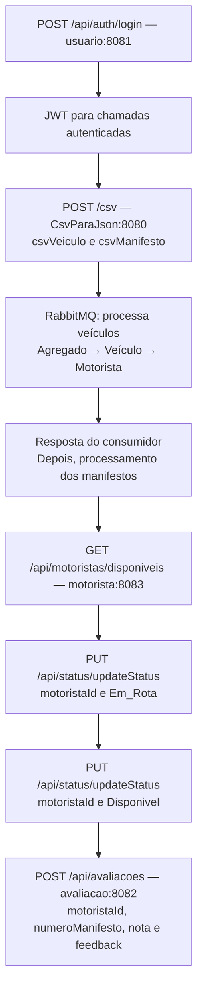

# Dicionário de Dados e Modelos JSON da API — FleetOps (NewLogística)

> **Projeto:** Plataforma de Gestão e Gamificação de Motoristas Agregados
>
> **Parceiro Acadêmico:** Newelog | FATEC SJC - 3º DSM
>
> **Banco de Dados:** MySQL; bancos padrão `usuario`, `veiculo` e `avaliacao`, separados por serviço.
>
> **Convenção:** nomes de coluna seguem o mapeamento JPA; nomes JSON seguem os DTOs da API.

---

## Sumário

1. [Resumo das Rotas Atuais dos Controles](#1-resumo-das-rotas-atuais-dos-controles)
   - [Rotas do ServicoMotorista — porta 8083 no Docker Compose](#rotas-do-servicomotorista--porta-8083-no-docker-compose)
   - [Rotas do usuário — porta 8081 no Docker Compose](#rotas-do-usuário--porta-8081-no-docker-compose)
   - [Rotas do avaliacao — porta 8082 no Docker Compose](#rotas-do-avaliacao--porta-8082-no-docker-compose)
   - [Rotas do CsvParaJson — porta 8080 no Docker Compose](#rotas-do-csvparajson--porta-8080-no-docker-compose)
2. [Critérios do Dicionário e Formatos da API](#2-critérios-do-dicionário-e-formatos-da-api)
3. [Tabela 1: `usuario` (Usuário do Sistema)](#3-tabela-1-usuario-usuário-do-sistema)
4. [Tabela 2: `agregado` (Parceiro Frotista)](#4-tabela-2-agregado-parceiro-frotista)
5. [Tabela 3: `veiculo` (Veículo da Frota)](#5-tabela-3-veiculo-veículo-da-frota)
6. [Tabela 4: `motorista` (Motorista Parceiro)](#6-tabela-4-motorista-motorista-parceiro)
7. [Tabela 5: `manifesto` (Registro de Viagem / Frete)](#7-tabela-5-manifesto-registro-de-viagem--frete)
8. [Tabela 6: `avaliacoes_frete` (Feedback e Avaliação Operacional)](#8-tabela-6-avaliacoes_frete-feedback-e-avaliação-operacional)
9. [Dicas de Integração Frontend (React) e Boas Práticas](#9-dicas-de-integração-frontend-react-e-boas-práticas)
10. [Registro das Correções das Tabelas](#10-registro-das-correções-das-tabelas--23102026)

---

## 1. Resumo das Rotas Atuais dos Controles

### Rotas do usuário — porta 8081 no Docker Compose

#### Autenticação e acesso

`POST /api/auth/login` é público. Todas as rotas `/api/usuarios/**` exigem JWT válido com perfil **`GERENCIA`**. O perfil `OPERACIONAL` não tem acesso à gestão de usuários.

Para requisições com corpo JSON, envie:

```http
Content-Type: application/json
Accept: application/json
```

Nas rotas de gestão, envie também:

```http
Authorization: Bearer <token>
```

Ausência de autenticação válida nas rotas protegidas resulta em `401 Unauthorized`; um usuário autenticado sem a permissão necessária recebe `403 Forbidden`.

#### Endpoints implementados

| Controller          | Método  | Rota                           | Parâmetros / corpo                   | Retorno HTTP                                                    | Resposta / comportamento                                                                       |
| :------------------ | :-----: | :----------------------------- | :----------------------------------- | :-------------------------------------------------------------- | :--------------------------------------------------------------------------------------------- |
| `AuthController`    | `POST`  | `/api/auth/login`              | `LoginRequestDTO`: `email` e `senha` | `200 OK` / `400 Bad Request` / `401 Unauthorized`               | Valida credenciais e situação do usuário; retorna `LoginResponseDTO` com JWT.                  |
| `UsuarioController` |  `GET`  | `/api/usuarios`                | Nenhum                               | `200 OK`                                                        | Array de `UsuarioResponse`, incluindo usuários ativos e inativos. Sem registros, retorna `[]`. |
| `UsuarioController` |  `GET`  | `/api/usuarios/{id}`           | `id`: `Long` na URL                  | `200 OK` / `404 Not Found`                                      | Objeto `UsuarioResponse` correspondente ao ID.                                                 |
| `UsuarioController` | `POST`  | `/api/usuarios`                | `UsuarioCreateRequest`               | `201 Created` / `400 Bad Request` / `409 Conflict`              | Cria usuário ativo, não primário; retorna `UsuarioResponse`.                                   |
| `UsuarioController` |  `PUT`  | `/api/usuarios/{id}`           | `id`: `Long`; `UsuarioUpdateRequest` | `200 OK` / `400 Bad Request` / `404 Not Found` / `409 Conflict` | Atualiza os dados cadastrais; senha opcional. Retorna `UsuarioResponse`.                       |
| `UsuarioController` | `PATCH` | `/api/usuarios/{id}/desativar` | `id`: `Long`; sem corpo              | `200 OK` / `400 Bad Request` / `404 Not Found`                  | Define `ativo=false`, sem excluir o registro; retorna `UsuarioResponse`.                       |
| `UsuarioController` | `PATCH` | `/api/usuarios/{id}/ativar`    | `id`: `Long`; sem corpo              | `200 OK` / `404 Not Found`                                      | Define `ativo=true`; retorna `UsuarioResponse`.                                                |

As rotas de gestão também podem retornar `401` e `403`, conforme a autenticação e o perfil. IDs com formato inválido, como texto no lugar de um número, podem resultar em `400`. A listagem não possui filtros nem paginação implementados. Não há endpoint DELETE neste módulo.

#### Login e token JWT

Exemplo de corpo para `POST /api/auth/login`:

```json
{
  "email": "pedro.operador@fleetops.com",
  "senha": "SenhaForte@2026"
}
```

O login usa **e-mail**, não o campo `login` do cadastro. `email` deve ser preenchido e ter formato válido; `senha` deve ser preenchida. O controller usa `@Valid` para validar a entrada.

| Campo de `LoginResponseDTO` | Tipo / significado                                                                                  |
| :-------------------------- | :-------------------------------------------------------------------------------------------------- |
| `token`                     | String com o JWT assinado.                                                                          |
| `tipo`                      | String `Bearer`.                                                                                    |
| `idUsuario`                 | Número com o ID do usuário autenticado.                                                             |
| `nome`                      | Nome do usuário.                                                                                    |
| `email`                     | E-mail usado na autenticação.                                                                       |
| `perfil`                    | `GERENCIA` ou `OPERACIONAL`.                                                                        |
| `expiraEm`                  | Número com o instante de expiração em milissegundos desde a época Unix; não representa uma duração. |

#### Cadastro, atualização e validações

Os nomes enviados à API seguem os DTOs, como `nome`, `email`, `login` e `perfil`; não são os nomes dos atributos da entidade, como `nomeUsuario` ou `perfilAcesso`.

| Campo    | Criação (`UsuarioCreateRequest`)                                      | Atualização (`UsuarioUpdateRequest`)                                                                                     |
| :------- | :-------------------------------------------------------------------- | :----------------------------------------------------------------------------------------------------------------------- |
| `nome`   | Obrigatório, não vazio, até 100 caracteres.                           | Mesmas exigências da criação.                                                                                            |
| `email`  | Obrigatório, não vazio, formato de e-mail, até 150 caracteres; único. | Mesmas exigências; pode manter o e-mail do próprio registro.                                                             |
| `senha`  | Obrigatória, não vazia, de 8 a 72 caracteres.                         | Opcional. Ausente, nula ou vazia mantém a senha; quando preenchida, deve respeitar o padrão de 8 a 72 caracteres do DTO. |
| `login`  | Obrigatório, não vazio, até 50 caracteres; único.                     | Mesmas exigências; pode manter o login do próprio registro.                                                              |
| `perfil` | Obrigatório: `GERENCIA` ou `OPERACIONAL`.                             | Mesmas exigências da criação.                                                                                            |
| `papel`  | Obrigatório; deve pertencer ao perfil informado.                      | Mesmas exigências da criação.                                                                                            |

O PUT exige os campos cadastrais obrigatórios, mesmo quando apenas um dado precisa mudar. A senha enviada é armazenada como hash BCrypt; os DTOs de resposta não expõem senha nem hash.

| `perfil`      | Valores compatíveis de `papel` |
| :------------ | :----------------------------- |
| `GERENCIA`    | `GERENTE_OPERACIONAL`, `LIDER` |
| `OPERACIONAL` | `OPERADOR_LOGISTICO`, `SAC`    |

Exemplo de corpo para `POST /api/usuarios`:

```json
{
  "nome": "Pedro Chaim",
  "email": "pedro.operador@fleetops.com",
  "senha": "SenhaForte@2026",
  "login": "pedro.chaim",
  "perfil": "GERENCIA",
  "papel": "GERENTE_OPERACIONAL"
}
```

Exemplo de `UsuarioResponse` retornado na criação (`201 Created`):

```json
{
  "id": 1,
  "nome": "Pedro Chaim",
  "email": "pedro.operador@fleetops.com",
  "login": "pedro.chaim",
  "perfil": "GERENCIA",
  "papel": "GERENTE_OPERACIONAL",
  "ativo": true,
  "primario": false
}
```

GET por ID, PUT e os dois PATCHs retornam esse mesmo conjunto de campos, com os valores do registro correspondente. O GET de listagem retorna um array desses objetos. `ativo` e `primario` não fazem parte dos DTOs de criação ou atualização.

Exemplo de corpo para `PUT /api/usuarios/1`, mantendo a senha atual:

```json
{
  "nome": "Pedro Chaim Silva",
  "email": "pedro.operador@fleetops.com",
  "login": "pedro.chaim",
  "perfil": "GERENCIA",
  "papel": "LIDER"
}
```

#### Regras de ativação e do usuário primário

- A criação pela API define `ativo=true` e `primario=false`.
- A desativação impede novos logins e mantém o registro no banco. O serviço impede desativar a própria conta ou qualquer usuário primário, retornando `400`.
- O usuário primário deve manter o perfil `GERENCIA`; tentar alterá-lo para `OPERACIONAL` retorna `400`.
- A ativação define `ativo=true`, inclusive se o registro já estiver ativo. Ativação e desativação retornam `200` com o usuário atualizado, não `204`.
- O filtro JWT atual valida o token e usa o perfil presente nas claims, sem consultar o estado atual do usuário no banco. Desativação e mudança de perfil não revogam automaticamente tokens já emitidos.

#### Erros tratados

Os handlers de negócio, validação e segurança descritos nesta subseção retornam um objeto com a propriedade `mensagem`.

| HTTP               | Situação                                                                                                                                               |
| :----------------- | :----------------------------------------------------------------------------------------------------------------------------------------------------- |
| `400 Bad Request`  | Falha de validação dos DTOs, JSON inválido, enums inválidos, papel incompatível com o perfil ou violação das regras da própria conta/usuário primário. |
| `401 Unauthorized` | Credenciais inválidas, usuário inativo no login ou falta de autenticação válida em rota protegida.                                                     |
| `403 Forbidden`    | Token autenticado sem permissão de gerência para acessar `/api/usuarios/**`.                                                                           |
| `404 Not Found`    | Usuário não encontrado pelo ID.                                                                                                                        |
| `409 Conflict`     | E-mail ou login já utilizado por outro registro.                                                                                                       |

Exemplo de erro `409 Conflict` para e-mail duplicado:

```json
{
  "mensagem": "Já existe um usuário com este e-mail."
}
```

As mensagens de validação podem ser concatenadas com `; `. JSON não legível pelo controller retorna `{"mensagem":"Corpo da requisição inválido (confira perfil e papel)."}`. Esses exemplos descrevem os erros tratados explicitamente, sem garantir esse formato para toda falha interna ou erro de conversão de parâmetros.

### Rotas do ServicoMotorista — porta 8083 no Docker Compose

#### Autenticação e cabeçalhos

Todas as rotas de negócio da tabela exigem um JWT válido. Envie:

```http
Authorization: Bearer <token>
Accept: application/json
```

Na atualização de status, envie também `Content-Type: application/json`. Sem autenticação válida, o serviço retorna `401 Unauthorized`. O endpoint de infraestrutura `GET /actuator/health`, usado pelo healthcheck do Compose, tem acesso público e não integra a tabela de rotas de negócio.

#### Endpoints implementados

Os retornos abaixo pressupõem uma requisição autenticada. Nas consultas por ID, `404` indica registro não encontrado; na consulta da última inserção, indica ausência de manifestos.

| Controller                   | Método | Rota                                    | Parâmetros / corpo                                                               | Retorno HTTP                                           | Resposta / comportamento                                                                                      |
| :--------------------------- | :----: | :-------------------------------------- | :------------------------------------------------------------------------------- | :----------------------------------------------------- | :------------------------------------------------------------------------------------------------------------ |
| `AgregadoController`         | `GET`  | `/api/agregados`                        | Nenhum                                                                           | `200 OK`                                               | Array de entidades `Agregado`.                                                                                |
| `AgregadoController`         | `GET`  | `/api/agregados/{id}`                   | `id`: `Long` na URL                                                              | `200 OK` / `404 Not Found`                             | Entidade `Agregado` correspondente ao ID.                                                                     |
| `VeiculoController`          | `GET`  | `/api/veiculos`                         | Query opcional: `tipo` (`TipoVeiculo`) e `subtipo` (`SubtipoVeiculo`)            | `200 OK`                                               | Array de `VeiculoDTO`. Se ambos forem enviados, somente `tipo` é aplicado.                                    |
| `VeiculoController`          | `GET`  | `/api/veiculos/{id}`                    | `id`: `Long` na URL                                                              | `200 OK` / `404 Not Found`                             | Objeto `VeiculoDTO`.                                                                                          |
| `VeiculoController`          | `GET`  | `/api/veiculos/tipo/{tipo}`             | `tipo`: constante de `TipoVeiculo` na URL                                        | `200 OK`                                               | Array de `VeiculoDTO` filtrado por tipo.                                                                      |
| `MotoristaController`        | `GET`  | `/api/motoristas`                       | Queries opcionais: `status` (`StatusMotorista`) e `veiculoIds` (lista de `Long`) | `200 OK`                                               | Array de `MotoristaDTO`. Os dois filtros podem ser combinados.                                                |
| `MotoristaController`        | `GET`  | `/api/motoristas/disponiveis`           | Nenhum                                                                           | `200 OK`                                               | Array de `MotoristaDTO` com status `Disponivel`. A consulta não reserva os motoristas.                        |
| `MotoristaController`        | `GET`  | `/api/motoristas/{id}`                  | `id`: `Long` na URL                                                              | `200 OK` / `404 Not Found`                             | Objeto `MotoristaDTO`.                                                                                        |
| `ManifestoController`        | `GET`  | `/api/manifestos`                       | Nenhum                                                                           | `200 OK`                                               | Array de `ManifestoDTO`.                                                                                      |
| `ManifestoController`        | `GET`  | `/api/manifestos/{id}`                  | `id`: `Long` na URL                                                              | `200 OK` / `404 Not Found`                             | Objeto `ManifestoDTO`.                                                                                        |
| `ManifestoController`        | `GET`  | `/api/manifestos/dataDoUltimoManifesto` | Nenhum                                                                           | `200 OK` / `404 Not Found`                             | Objeto `ResponseDate` com a propriedade `data`, obtida de `dataInsert` do registro com inserção mais recente. |
| `StatusMotoristasController` | `PUT`  | `/api/status/updateStatus`              | JSON `StatusDTO`: `motoristaId` e `status`                                       | `204 No Content` / `400 Bad Request` / `404 Not Found` | Atualiza `status` e `statusUpdatedAt` do motorista. Sucesso sem corpo de resposta.                            |

Listagens sem resultados retornam `200 OK` com `[]`. Parâmetros com formato inválido, como um ID não numérico ou uma constante de enum inexistente, podem retornar `400 Bad Request`.

#### Filtros e valores aceitos

Use a grafia exata das constantes:

| Parâmetro    | Valores aceitos                                                                                                                                                                                                          |
| :----------- | :----------------------------------------------------------------------------------------------------------------------------------------------------------------------------------------------------------------------- |
| `status`     | `Disponivel`, `Em_Rota`, `Indisponivel`, `Indesejado`                                                                                                                                                                    |
| `tipo`       | `URBANOS_EXPRESS`, `URBANOS_DE_CARGA`, `PESADOS`, `ARTICULADOS`                                                                                                                                                          |
| `subtipo`    | `MOTOCICLETAS`, `AUTOMOVEIS`, `FIORINO`, `VAN`, `VUC`, `TRES_QUARTOS`, `TOCO`, `TRUCK`, `BI_TRUCK`, `CAVALO_MECANICO`, `CAVALO_MECANICO_TRUCADO`, `SEMI_REBOQUE_2_EIXOS`, `SEMI_REBOQUE_3_EIXOS`, `SEMI_REBOQUE_4_EIXOS` |
| `veiculoIds` | IDs de veículos separados por vírgula, por exemplo `1,2`.                                                                                                                                                                |

Exemplos de consultas, relativos à URL base:

```http
GET /api/motoristas?status=Disponivel
GET /api/motoristas?veiculoIds=1,2
GET /api/motoristas?status=Disponivel&veiculoIds=1,2
GET /api/veiculos?tipo=URBANOS_EXPRESS
GET /api/veiculos?subtipo=FIORINO
GET /api/veiculos/tipo/PESADOS
```

Em motoristas, `status` e `veiculoIds` são aplicados em conjunto quando ambos estão preenchidos; sem filtros, todos os motoristas são listados. Em veículos, o serviço verifica primeiro `tipo` e só consulta por `subtipo` se `tipo` não tiver sido informado.

#### Formatos das respostas

| Modelo         | Propriedades retornadas                                                                                                                                                                                                                                    |
| :------------- | :--------------------------------------------------------------------------------------------------------------------------------------------------------------------------------------------------------------------------------------------------------- |
| `Agregado`     | `idAgregado`, `nomeAgregado`, `cnpjAgregado`, `contatoAgregado`, `motoristas`, `veiculos`. As duas últimas propriedades são coleções de entidades.                                                                                                         |
| `VeiculoDTO`   | `idVeiculo`, `placaVeiculo`, `tipoVeiculo`, `subtipoVeiculo`, `agregadoId`.                                                                                                                                                                                |
| `MotoristaDTO` | `idMotorista`, `nomeMotorista`, `cpfMotorista`, `contatoMotorista`, `status`, `statusUpdatedAt`, `contadorRotaSp`, `notaMedia`, `veiculo`, `agregadoId`. `veiculo` é um `VeiculoDTO` aninhado e pode ser nulo.                                             |
| `ManifestoDTO` | `idManifesto`, `dataManifesto`, `destino`, `dataInsert`, `valorRecebido`, `freteEmpresa`, `freteAgregado`, `observacoes`, `veiculo`, `agregado`, `motorista`. Os relacionamentos são, respectivamente, `VeiculoDTO`, entidade `Agregado` e `MotoristaDTO`. |
| `ResponseDate` | `data`, uma data ISO no formato `YYYY-MM-DD`.                                                                                                                                                                                                              |

As datas `dataManifesto` e `dataInsert` usam `YYYY-MM-DD`; `statusUpdatedAt` é uma data/hora local ISO, como `2026-10-23T14:30:00`, e pode ser nulo antes da primeira atualização de status.

Exemplo de `GET /api/manifestos/dataDoUltimoManifesto`:

```json
{
  "data": "2026-10-23"
}
```

Essa rota ordena por `dataInsert` e retorna a data de inserção, não a maior `dataManifesto` nem a data da última viagem de um motorista específico.

#### Atualização de status

Exemplo de corpo para `PUT /api/status/updateStatus`, considerando um motorista atualmente `Disponivel`:

```json
{
  "motoristaId": 1,
  "status": "Em_Rota"
}
```

O sucesso retorna **`204 No Content`**. O cliente deve tratar esse retorno sem tentar ler JSON do corpo.

Regras implementadas em `StatusMotoristasService`:

- A partir de `Disponivel`, são aceitos `Em_Rota`, `Indisponivel` e `Indesejado`. Enviar `Disponivel` novamente resulta em `400 Bad Request`.
- A partir dos outros três estados, o serviço aceita qualquer uma das quatro constantes do enum, inclusive a repetição do status atual.
- O método `Motorista.atualizaStatus` altera o status e registra `statusUpdatedAt` com a data/hora atual.
- Motorista inexistente gera `404 Not Found`. Os erros de motorista inexistente e de transição inválida são tratados por `ExceptionController` e retornam `ResponseErrorDTO`.

Exemplo do corpo de erro para um motorista de ID `999` inexistente:

```json
{
  "mensagem": "Não é possível encontrar o motorista 999"
}
```

Exemplo do corpo de erro ao tentar manter `Disponivel` quando o motorista já está nesse estado:

```json
{
  "mensagem": "Não é possível alterar diretamente o status atual para Disponivel"
}
```

O módulo não implementa POSTs de cadastro de agregados, veículos, motoristas ou manifestos, nem `PATCH /api/motoristas/{id}/status`. Esses cadastros são alimentados pela importação recebida em `OuvinteCsvParaJson` via RabbitMQ. As rotas de usuários, avaliações e upload de CSV pertencem a outros módulos.

### Rotas do avaliacao — porta 8082 no Docker Compose

#### Autenticação e cabeçalhos

Todas as rotas de avaliações exigem JWT válido. Envie:

```http
Authorization: Bearer <token>
Accept: application/json
```

No POST, envie também `Content-Type: application/json`. A configuração exige autenticação, sem restringir essas rotas ao perfil `GERENCIA`. O filtro usa o e-mail e o perfil presentes no token. Ausência de autenticação válida resulta em `401 Unauthorized`.

#### Endpoints implementados

Todos os endpoints da tabela pertencem a `AvaliacaoFreteController`. Os retornos abaixo pressupõem uma requisição autenticada.

| Método | Rota                   | Parâmetros / corpo                                                                | Retorno HTTP                      | Resposta / comportamento                                          |
| :----: | :--------------------- | :-------------------------------------------------------------------------------- | :-------------------------------- | :---------------------------------------------------------------- |
| `GET`  | `/api/avaliacoes`      | Nenhum                                                                            | `200 OK`                          | Array de `AvaliacaoResponseDTO`. Sem registros, retorna `[]`.     |
| `GET`  | `/api/avaliacoes/{id}` | `id`: `Long` na URL                                                               | `200 OK` / `404 Not Found`        | Retorna `AvaliacaoResponseDTO` da avaliação identificada pelo ID. |
| `POST` | `/api/avaliacoes`      | JSON `AvaliacaoRequestDTO`: `motoristaId`, `nota`, `numeroManifesto` e `feedback` | `201 Created` / `400 Bad Request` | Registra a avaliação e retorna `AvaliacaoResponseDTO`.            |

As três rotas também podem retornar `401` por falha de autenticação. Erros internos podem resultar em `500`, sem contrato específico de corpo definido pelo handler do módulo.

A listagem não implementa filtros, paginação ou ordenação explícita. Embora o repositório tenha `findByMotoristaIdOrderByDataRegistroDesc`, esse método não está exposto em uma rota ou parâmetro do controller. Não há endpoints PUT, PATCH ou DELETE neste módulo.

#### Corpo de criação e validações

O controller aplica `@Valid` em `AvaliacaoRequestDTO`. Todos os quatro campos são obrigatórios:

| Campo             | Tipo Java / JSON           | Validações / comportamento                                                                                                                       |
| :---------------- | :------------------------- | :----------------------------------------------------------------------------------------------------------------------------------------------- |
| `motoristaId`     | `Long` / número inteiro    | `@NotNull`; o DTO não declara mínimo positivo. O serviço armazena o ID, sem consultar a existência do motorista.                                 |
| `nota`            | `Integer` / número inteiro | `@NotNull`, `@Min(1)` e `@Max(5)`; o serviço também valida a escala com `EscalaNota.fromValor`.                                                  |
| `numeroManifesto` | `Integer` / número inteiro | `@NotNull`, `@Min(1)`; deve ser maior que zero. O serviço não consulta a existência do manifesto.                                                |
| `feedback`        | `String` / texto           | `@NotBlank`; não pode ser vazio ou conter somente espaços. O serviço aplica `trim()` antes de salvar. Não há limite de tamanho declarado no DTO. |

Envie IDs e número do manifesto como campos escalares. Objetos aninhados `usuario`, `motorista` e `manifesto`, assim como `notaComentario`, não fazem parte desse contrato.

Escala de notas definida por `EscalaNota`:

| `nota` | Descrição |
| :----: | :-------- |
|   1    | Péssimo   |
|   2    | Ruim      |
|   3    | Regular   |
|   4    | Bom       |
|   5    | Excelente |

Exemplo de corpo para `POST /api/avaliacoes`:

```json
{
  "motoristaId": 1,
  "nota": 5,
  "numeroManifesto": 1001,
  "feedback": "Motorista pontual e cuidadoso com a carga."
}
```

#### Resposta da criação e das consultas

| Campo de `AvaliacaoResponseDTO` | Tipo / significado                                                          |
| :------------------------------ | :-------------------------------------------------------------------------- |
| `mensagem`                      | String de confirmação no POST; string vazia nos GETs.                       |
| `id`                            | Número com o ID gerado para a avaliação.                                    |
| `motoristaId`                   | Número com o ID do motorista informado.                                     |
| `nota`                          | Número inteiro de 1 a 5.                                                    |
| `numeroManifesto`               | Número inteiro do manifesto informado.                                      |
| `descricaoNota`                 | Descrição da escala no POST; string vazia nos GETs.                         |
| `feedback`                      | Texto salvo, sem espaços nas extremidades.                                  |
| `dataRegistro`                  | Data/hora local ISO, sem offset, preenchida pela entidade em `@PrePersist`. |

Exemplo de resposta `201 Created` do POST:

```json
{
  "mensagem": "Avaliação registrada com sucesso",
  "id": 1,
  "motoristaId": 1,
  "nota": 5,
  "numeroManifesto": 1001,
  "descricaoNota": "Excelente",
  "feedback": "Motorista pontual e cuidadoso com a carga.",
  "dataRegistro": "2026-10-23T14:30:00"
}
```

Nas consultas, o serviço chama `AvaliacaoResponseDTOMapper.toDTO(avaliacao, "", "")`. Portanto, o frontend deve considerar `mensagem` e `descricaoNota` vazias, mesmo quando a nota estiver preenchida.

Exemplo de resposta `200 OK` de `GET /api/avaliacoes/1`:

```json
{
  "mensagem": "",
  "id": 1,
  "motoristaId": 1,
  "nota": 5,
  "numeroManifesto": 1001,
  "descricaoNota": "",
  "feedback": "Motorista pontual e cuidadoso com a carga.",
  "dataRegistro": "2026-10-23T14:30:00"
}
```

`GET /api/avaliacoes` retorna um array desses objetos. Registrar uma avaliação não recalcula nem atualiza `notaMedia` do motorista em outro serviço; o fluxo atual apenas salva a avaliação e monta o DTO de resposta.

#### Erros tratados

O módulo possui formatos diferentes conforme a falha:

| HTTP               | Situação                                                                       | Formato do corpo                                                    |
| :----------------- | :----------------------------------------------------------------------------- | :------------------------------------------------------------------ |
| `400 Bad Request`  | Falha de Bean Validation, como nota fora de 1 a 5 ou campo obrigatório ausente | `timestamp`, `status`, `error` e `fields`, com mensagens por campo. |
| `400 Bad Request`  | `IllegalArgumentException`, incluindo validação adicional da escala no serviço | `timestamp`, `status` e `error`, sem `fields`.                      |
| `401 Unauthorized` | Requisição sem autenticação válida                                             | Tratado por Spring Security; não usa os DTOs de erro do controller. |
| `404 Not Found`    | Avaliação inexistente na busca por ID                                          | `ResponseErrorDTO`, com `titulo` e `mensagem`.                      |

Exemplo de `400 Bad Request` ao enviar `nota: 6`, com os demais campos válidos:

```json
{
  "timestamp": "2026-10-23T14:30:00",
  "status": 400,
  "error": "Dados inválidos",
  "fields": {
    "nota": "A nota deve ser no máximo 5 (Excelente)"
  }
}
```

Exemplo de `404 Not Found` para `GET /api/avaliacoes/999`, quando a avaliação não existe:

```json
{
  "titulo": "Não foi possivel encontrar a avaliação: 999",
  "mensagem": "Não foi possível retornar avaliação"
}
```

JSON malformado e IDs com formato inválido também podem resultar em `400`, mas não possuem handlers específicos neste módulo. Não se deve presumir que essas falhas usem o formato de validação com `fields` ou o DTO com `titulo` e `mensagem`.

### Rotas do CsvParaJson — porta 8080 no Docker Compose

#### Autenticação e endpoint implementado

A rota exige JWT válido, sem restrição específica ao perfil `GERENCIA`. Envie:

```http
Authorization: Bearer <token>
Accept: application/json
```

| Controller              | Método | Rota   | Entrada                                                           | Retorno HTTP                  | Resposta / comportamento                                                                                                                                                                                                                             |
| :---------------------- | :----: | :----- | :---------------------------------------------------------------- | :---------------------------- | :--------------------------------------------------------------------------------------------------------------------------------------------------------------------------------------------------------------------------------------------------- |
| `CsvVeiculosController` | `POST` | `/csv` | `multipart/form-data`, com arquivos `csvVeiculo` e `csvManifesto` | `200 OK` / `401 Unauthorized` | Processa os arquivos, valida as linhas e envia os resultados ao serviço consumidor. No sucesso, retorna `ResultadoCsv<VeiculoDTO, ManifestoDTO>`. Os erros tratados do processamento também retornam `200`, com `ErroDTO`, conforme descrito abaixo. |

Não há prefixo `/api` nessa rota, nem endpoints GET, PUT, PATCH ou DELETE no controller. Sem autenticação válida, Spring Security retorna `401`, fora do contrato de erro de processamento de CSV.

#### Envio dos arquivos

| Parte multipart | Tipo                    | Conteúdo                                                               |
| :-------------- | :---------------------- | :--------------------------------------------------------------------- |
| `csvVeiculo`    | Arquivo `MultipartFile` | CSV com veículos, agregados e motoristas. Processado primeiro.         |
| `csvManifesto`  | Arquivo `MultipartFile` | CSV com manifestos. Processado depois do retorno da etapa de veículos. |

Envie os dois arquivos na mesma requisição. O serviço rejeita arquivo ausente (`null`), mas não verifica explicitamente `MultipartFile.isEmpty()`. O controller declara os parâmetros com `@PathParam`; os nomes usados na integração são `csvVeiculo` e `csvManifesto`.

Use `FormData` no navegador e deixe o cliente definir o `Content-Type` multipart com seu boundary. Não envie JSON ou um caminho de arquivo no lugar do conteúdo do arquivo.

Exemplo de upload com `curl`, substituindo o token e os caminhos locais:

```bash
curl --request POST 'http://localhost:8080/csv' \
  --header 'Authorization: Bearer <token>' \
  --header 'Accept: application/json' \
  --form 'csvVeiculo=@/caminho/veiculos.csv' \
  --form 'csvManifesto=@/caminho/manifestos.csv'
```

O verificador de extensão aceita somente o sufixo literal `csv`: um nome terminado em `.CSV` não passa nessa verificação. O parser extrai a primeira linha como cabeçalho, detecta o formato automaticamente e ignora espaços nas extremidades dos campos. O encoding é detectado com `UniversalDetector`; o código atual não exige exclusivamente UTF-8 nem define fallback quando a detecção retorna nulo.

#### Cabeçalhos do CSV de veículos

Os nomes abaixo vêm das anotações `@Parsed` de `VeiculoDTO`. Use os cabeçalhos indicados, incluindo espaços e acentos.

| Cabeçalho CSV       | Campo JSON da resposta | Validação / formato                                                                                                                        |
| :------------------ | :--------------------- | :----------------------------------------------------------------------------------------------------------------------------------------- |
| `Placa (id)`        | `placa`                | Obrigatório; exatamente 7 letras maiúsculas ou números, sem espaços ou pontuação.                                                          |
| `Agregado`          | `agregado`             | Obrigatório; não pode conter dígitos.                                                                                                      |
| `Status do Veículo` | `status`               | Obrigatório; `Ativo` ou `Inativo`. Este é o status do veículo no CSV, não `StatusMotorista`.                                               |
| `Motorista Padrão`  | `motorista`            | Obrigatório; não pode conter dígitos.                                                                                                      |
| `Tipo Veículo`      | `tipoVeiculo`          | Enum obrigatório; no CSV, use a descrição de `TipoVeiculo`, como `Urbanos Express`.                                                        |
| `Subtipo Veículo`   | `subtipoVeiculo`       | Enum obrigatório; no CSV, use a descrição de `SubtipoVeiculo`, como `Fiorino`.                                                             |
| `CPF Motorista`     | `cpfmotorista`         | Regex de CPF com 11 dígitos e pontos opcionais, sem hífen; o DTO não declara `@NotBlank`. Use os 11 dígitos sem pontuação para integração. |
| `CNPJ Agregado`     | `cnpjagregado`         | Regex com 12 letras maiúsculas/números seguidos de 2 dígitos; sem pontuação. O DTO não declara `@NotBlank`.                                |
| `Contato Motorista` | `contatomotorista`     | Regex com 10 ou 11 dígitos, sem pontuação; sem `@NotBlank`.                                                                                |
| `Contato Agregado`  | `contatoagregado`      | Regex com 10 ou 11 dígitos, sem pontuação; sem `@NotBlank`.                                                                                |

As validações `@Pattern` não substituem validação de dígitos verificadores ou de existência dos registros. Campos com apenas `@Pattern` não rejeitam valores nulos por essa anotação; strings vazias podem falhar na regex.

O CSV usa descrições porque os dois enums estão configurados com `EnumSelector.CUSTOM_FIELD` e `customElement="descricao"`. O JSON retornado usa as constantes dos enums:

| Descrição de tipo no CSV | `tipoVeiculo` no JSON |
| :----------------------- | :-------------------- |
| `Urbanos Express`        | `URBANOS_EXPRESS`     |
| `Urbanos de Carga`       | `URBANOS_DE_CARGA`    |
| `Pesados`                | `PESADOS`             |
| `Articulados`            | `ARTICULADOS`         |

Exemplos de subtipo: `Fiorino` → `FIORINO`, `3/4` → `TRES_QUARTOS`, `Toco ou Semi-pesado` → `TOCO`, `Semi-reboque com 02 Eixos` → `SEMI_REBOQUE_2_EIXOS`. As demais descrições estão no enum `SubtipoVeiculo`. O validador de linhas não verifica se tipo e subtipo formam uma combinação compatível.

#### Cabeçalhos do CSV de manifestos

| Cabeçalho CSV           | Campo JSON da resposta | Validação / formato                                                                                                                      |
| :---------------------- | :--------------------- | :--------------------------------------------------------------------------------------------------------------------------------------- |
| `Manifesto (id)`        | `manifestoid`          | Obrigatório; somente dígitos no CSV. O getter converte para `Long`, retornando número no JSON.                                           |
| `Data`                  | `data`                 | Obrigatório; texto `dd/MM/aaaa`, como `23/10/2026`. A regex verifica o formato, sem garantir uma data válida de calendário.              |
| `Motorista`             | `motorista`            | Obrigatório; somente letras, espaços e acentos.                                                                                          |
| `CPF (motorista)`       | `cpfmotorista`         | Mesma regex de CPF do DTO de veículos; sem `@NotBlank`.                                                                                  |
| `Agregado`              | `agregado`             | Obrigatório; não pode conter dígitos.                                                                                                    |
| `CNPJ (agregado)`       | `cnpjagregado`         | Mesma regex de CNPJ do DTO de veículos; sem `@NotBlank`.                                                                                 |
| `Veículo (placa)`       | `placa`                | Obrigatório; exatamente 7 letras maiúsculas ou números.                                                                                  |
| `Destino`               | `destino`              | Obrigatório; somente letras, espaços e acentos.                                                                                          |
| `Valor Frete(agregado)` | `valorfreteagregado`   | Obrigatório; moeda brasileira com 2 casas decimais, por exemplo `2.200,00`. O getter retorna `BigDecimal`, serializado como número JSON. |
| `Valor Frete(empresa)`  | `valorfreteempresa`    | Obrigatório; mesmo formato monetário, por exemplo `3.500,00`; número no JSON.                                                            |
| `Observações`           | `observacoes`          | Sem validação de conteúdo declarada.                                                                                                     |

As datas permanecem como texto no DTO de importação. Os campos e formatos desta subseção são os do upload; diferem dos DTOs REST de consulta do serviço de motoristas.

#### Formato da resposta

| Campo                   | Conteúdo                                                                              |
| :---------------------- | :------------------------------------------------------------------------------------ |
| `resultadoLinhasDoCsv`  | Resultado do CSV de veículos, com arrays `validos` e `invalidos`.                     |
| `resultadoLinhasDoCsv2` | Resultado do CSV de manifestos, com arrays `validos` e `invalidos`.                   |
| `validos`               | Objetos aprovados pela Bean Validation, no formato de `VeiculoDTO` ou `ManifestoDTO`. |
| `invalidos`             | Objetos com `linha` e `mensagem`; `mensagem` é um array de textos de validação.       |

O contador do validador começa em `linha: 2`, considerando o cabeçalho como a primeira linha, e avança por objeto produzido pelo parser. Erros de conversão do parser recebem valor padrão nulo; não há garantia de que todo erro de parsing seja relatado como um erro de linha.

Exemplo de resposta `200 OK`, com uma linha válida de cada arquivo e uma linha inválida de veículos:

```json
{
  "resultadoLinhasDoCsv": {
    "validos": [
      {
        "placa": "VXX3L65",
        "agregado": "Transportes Carga Certa Ltda",
        "status": "Ativo",
        "motorista": "João Carlos Rodrigues",
        "tipoVeiculo": "URBANOS_EXPRESS",
        "subtipoVeiculo": "FIORINO",
        "cpfmotorista": "12345678901",
        "cnpjagregado": "12345678000199",
        "contatomotorista": "12981112233",
        "contatoagregado": "1239218800"
      }
    ],
    "invalidos": [
      {
        "linha": 3,
        "mensagem": [
          "A placa deve ter exatamente 7 caracteres (letras e números, sem hífen, barra ou espaços)"
        ]
      }
    ]
  },
  "resultadoLinhasDoCsv2": {
    "validos": [
      {
        "manifestoid": 1001,
        "data": "23/10/2026",
        "motorista": "João Carlos Rodrigues",
        "cpfmotorista": "12345678901",
        "agregado": "Transportes Carga Certa Ltda",
        "cnpjagregado": "12345678000199",
        "placa": "VXX3L65",
        "destino": "São Paulo",
        "valorfreteagregado": 2200.0,
        "valorfreteempresa": 3500.0,
        "observacoes": "Entrega no período da manhã"
      }
    ],
    "invalidos": []
  }
}
```

Linhas inválidas não interrompem, por si só, a operação: são separadas das válidas e retornadas no relatório. A resposta descreve validação e processamento, sem detalhar o resultado de persistência de cada registro no consumidor.

#### Integração com RabbitMQ

O controller processa veículos e espera a resposta do consumidor antes de iniciar os manifestos. Para cada arquivo, `CsvParaJson.RetornarJson` envia o objeto `ResultadoLinhasDoCsv` inteiro usando `convertSendAndReceiveAsType`, esperando um `Boolean`.

| Etapa      | Exchange           | Routing key                  |
| :--------- | :----------------- | :--------------------------- |
| Veículos   | `veiculo.excharge` | `retornojsonVeiculos.queue`  |
| Manifestos | `veiculo.excharge` | `retornoJsonManifesto.queue` |

O timeout de resposta está configurado como `spring.rabbitmq.template.reply-timeout=5m`. Se a resposta for nula, o serviço lança `ErroDeServicodeConsumo`; o código não rejeita explicitamente o valor `false`. Não existe transação única entre os dois arquivos: uma falha nos manifestos não desfaz automaticamente o processamento anterior dos veículos.

#### Erros tratados e status HTTP atual

`ManipuladorExcessaoCsv` retorna `ErroDTO`, com `titulo` e `mensagem`, sem `ResponseEntity` ou `@ResponseStatus`. Assim, **os erros tratados abaixo retornam HTTP `200 OK` no código atual**. O frontend precisa diferenciar o relatório `ResultadoCsv` do objeto `ErroDTO`, além de consultar o status HTTP.

| Situação                                          | `titulo`                                     | `mensagem`                                |
| :------------------------------------------------ | :------------------------------------------- | :---------------------------------------- |
| Arquivo ausente                                   | `Verifique sua requisição`                   | `A requisição possui um arquivo faltando` |
| Extensão rejeitada                                | `Esse arquivo não possui a extensão correta` | `Só permitimos arquivos .csv`             |
| Falha de leitura dos bytes para detectar encoding | `A leitura desse arquivo falhou`             | `Não foi possivel encontrar o encoding`   |
| `IOException` ao ler o arquivo                    | `O arquivo <nome> não foi lido`              | `Problema ao ler esse arquivo`            |
| Consumidor não respondeu, com resultado nulo      | `Servico Não Respondeu`                      | `Problema ao salvar os dados do csv`      |

Exemplo do corpo de erro quando um arquivo está ausente, também com `200 OK`:

```json
{
  "titulo": "Verifique sua requisição",
  "mensagem": "A requisição possui um arquivo faltando"
}
```

Existe um handler para `ErroDeEncoding`, mas a verificação que exigia UTF-8 está comentada e não é executada no fluxo atual. Falhas não tratadas, como problemas de mensageria ou de charset não convertidos nas exceções acima, podem resultar em `500` com outro formato. Rejeições do próprio processamento multipart também não seguem necessariamente `ErroDTO`.

**Fontes desta subseção:** [CsvVeiculosController](../../Back-End/CsvParaJson/src/main/java/com/fleetops/CsvParaJson/controller/CsvVeiculosController.java), [serviços de parsing e validação](../../Back-End/CsvParaJson/src/main/java/com/fleetops/CsvParaJson/service), [DTOs](../../Back-End/CsvParaJson/src/main/java/com/fleetops/CsvParaJson/dto/response), [enums e descrições](../../Back-End/CsvParaJson/src/main/java/com/fleetops/CsvParaJson/enums), [tratamento de erros](../../Back-End/CsvParaJson/src/main/java/com/fleetops/CsvParaJson/exceptions), [RabbitConfig](../../Back-End/CsvParaJson/src/main/java/com/fleetops/CsvParaJson/config/RabbitConfig.java), [SecurityConfig](../../Back-End/CsvParaJson/src/main/java/com/fleetops/CsvParaJson/config/SecurityConfig.java), [configuração do timeout](../../Back-End/CsvParaJson/src/main/resources/application.properties) e [Docker Compose](../../Back-End/docker-compose.yml).

---

### Fluxo Operacional Recomendado (Ciclo de Vida das Rotas)

Os cadastros operacionais vêm do upload CSV; a atualização de status e o registro de avaliações usam rotas próprias.



A importação de manifesto não altera automaticamente o status ou os contadores do motorista. O registro de avaliação não recalcula sua média no serviço de motoristas. A consulta de disponíveis não reserva motoristas entre operadores.

### Resumo por Serviço e Papel no Negócio

- **`usuario`:** autentica por `AuthController` e gerencia usuários por `UsuarioController`, com acesso de gerência às operações de cadastro e manutenção.
- **`CsvParaJson`:** recebe os dois arquivos em `CsvVeiculosController`, separa linhas válidas/inválidas e envia os resultados ao consumidor por RabbitMQ.
- **`servicoMotorista`:** consulta agregados, veículos, motoristas e manifestos pelos respectivos controllers; `StatusMotoristasController` recebe as alterações de status.
- **`avaliacao`:** `AvaliacaoFreteController` registra e consulta avaliações com notas de 1 a 5, sem atualização automática da média do motorista.

---

## 2. Critérios do Dicionário e Formatos da API

| Serviço            | Banco padrão na conexão                    | Tabelas mapeadas pelas entidades                |
| :----------------- | :----------------------------------------- | :---------------------------------------------- |
| `usuario`          | `usuario`                                  | `usuario`                                       |
| `servicoMotorista` | `veiculo`                                  | `agregado`, `veiculo`, `motorista`, `manifesto` |
| `avaliacao`        | `avaliacao`                                | `avaliacoes_frete`                              |
| `CsvParaJson`      | Sem conexão de banco configurada no módulo | Nenhuma entidade JPA; envia dados por RabbitMQ. |

Os bancos acima vêm das configurações de conexão e do Compose; podem ser sobrescritos pelo ambiente. As seis entidades persistentes estão cobertas nas seções 3 a 8.

- **Coluna / nome JPA:** nome declarado em `@Column` ou `@JoinColumn`; quando não há nome explícito, é indicado o atributo. A estratégia de nomes físicos pode transformar os identificadores declarados, especialmente `freteEmp` e `freteAgregado`.
- **Tipo SQL de referência:** correspondência do tipo Java e dos parâmetros das anotações para MySQL. `Long` corresponde a `BIGINT`; a representação exata de enums `STRING`, booleanos, ponto flutuante e data/hora depende do Hibernate/dialeto. Esses tipos não foram obtidos por inspeção do banco.
- **Obrigatoriedade:** `nullable=false`/junções descrevem o mapeamento; `@NotNull`, `@NotBlank` e outras constraints descrevem Bean Validation. A ausência de `nullable=false` explícito não confirma que uma coluna real aceite nulo, pois a geração de DDL também pode considerar validações.
- **Valores iniciais:** valores definidos no atributo ou em `@Builder.Default` são defaults em Java, sem implicar `DEFAULT` SQL. A exceção explicitamente declarada neste modelo é `Usuario.primario`, com `columnDefinition="bit default 0"`.
- **JSON:** os exemplos seguem o contrato REST atual; propriedades de DTO podem diferir das propriedades Java da entidade. Listagens retornam arrays; exemplos de consulta por ID retornam um objeto.
- **Datas:** `LocalDate` usa `YYYY-MM-DD`; `LocalDateTime` usa data/hora local ISO sem offset. Datas e valores monetários de entrada do CSV seguem o contrato próprio da seção de `CsvParaJson`.

---

## 3. Tabela 1: `usuario` (Usuário do Sistema)

**Serviço:** `usuario`. Armazena os usuários da plataforma. A API recebe `UsuarioCreateRequest`/`UsuarioUpdateRequest` e retorna `UsuarioResponse`.

### Dicionário de Dados

| Coluna / nome JPA | Propriedade Java | JSON da API               | Tipo Java      | Tipo SQL de referência    | Obrigatoriedade / restrições                                                                                                     |
| :---------------- | :--------------- | :------------------------ | :------------- | :------------------------ | :------------------------------------------------------------------------------------------------------------------------------- |
| `id_usuario`      | `idUsuario`      | `id` (resposta)           | `Long`         | `BIGINT`                  | PK gerada por `IDENTITY`.                                                                                                        |
| `nome_usuario`    | `nomeUsuario`    | `nome`                    | `String`       | `VARCHAR(100)`            | `nullable=false`; `@NotBlank`, máximo 100 na entidade e no request.                                                              |
| `email_usuario`   | `emailUsuario`   | `email`                   | `String`       | `VARCHAR(150)`            | Único, `nullable=false`; `@NotBlank`, `@Email`, máximo 150.                                                                      |
| `senha_usuario`   | `senhaUsuario`   | `senha` (somente entrada) | `String`       | `VARCHAR(255)`            | `nullable=false`; na entidade, `@NotBlank` e máximo 255. Na criação, senha de 8 a 72 caracteres; o serviço armazena hash BCrypt. |
| `perfil_acesso`   | `perfilAcesso`   | `perfil`                  | `PerfilAcesso` | Enum `STRING`, length 20  | `nullable=false`, `@NotNull`; `OPERACIONAL` ou `GERENCIA`.                                                                       |
| `ativo`           | `ativo`          | `ativo` (resposta)        | `Boolean`      | Booleano                  | `nullable=false`; valor inicial em Java e na criação pela API: `true`.                                                           |
| `papel_usuario`   | `papel`          | `papel`                   | `Papel`        | Enum `STRING`, length 30  | Sem `nullable=false` explícito na entidade; obrigatório nos requests, validado conforme o perfil.                                |
| `login_usuario`   | `loginUsuario`   | `login`                   | `String`       | `VARCHAR(50)`             | Único, máximo 50; sem `nullable=false` explícito. `@NotBlank` nos requests.                                                      |
| `primario`        | `primario`       | `primario` (resposta)     | `Boolean`      | `BIT DEFAULT 0` explícito | `nullable=false`; valor inicial em Java e na criação pela API: `false`.                                                          |

Papéis de `GERENCIA`: `GERENTE_OPERACIONAL`, `LIDER`. Papéis de `OPERACIONAL`: `OPERADOR_LOGISTICO`, `SAC`. `permissaoGerente` não existe no modelo atual. A senha é omitida das respostas; no PUT, sua ausência, valor nulo ou vazio mantém a senha existente, respeitadas as validações do request quando preenchida.

### Exemplo de criação (`POST /api/usuarios`, porta 8081)

Requer JWT com perfil `GERENCIA`.

```json
{
  "nome": "Pedro Chaim",
  "email": "pedro.operador@fleetops.com",
  "senha": "SenhaForte@2026",
  "login": "pedro.chaim",
  "perfil": "GERENCIA",
  "papel": "GERENTE_OPERACIONAL"
}
```

### Exemplo de resposta (`201 Created`)

```json
{
  "id": 1,
  "nome": "Pedro Chaim",
  "email": "pedro.operador@fleetops.com",
  "login": "pedro.chaim",
  "perfil": "GERENCIA",
  "papel": "GERENTE_OPERACIONAL",
  "ativo": true,
  "primario": false
}
```

---

## 4. Tabela 2: `agregado` (Parceiro Frotista)

**Serviço:** `servicoMotorista`. Representa o parceiro frotista. O cadastro é alimentado pela importação; o controller oferece consultas GET.

### Dicionário de Dados

| Coluna / nome JPA  | Propriedade Java  | JSON da API       | Tipo Java | Tipo SQL de referência | Obrigatoriedade / restrições                                                                                               |
| :----------------- | :---------------- | :---------------- | :-------- | :--------------------- | :------------------------------------------------------------------------------------------------------------------------- |
| `id_agregado`      | `idAgregado`      | `idAgregado`      | `Long`    | `BIGINT`               | PK gerada por `IDENTITY`.                                                                                                  |
| `nome_agregado`    | `nomeAgregado`    | `nomeAgregado`    | `String`  | `VARCHAR(150)`         | `nullable=false`; `@NotBlank`, máximo 150.                                                                                 |
| `cnpj_agregado`    | `cnpjAgregado`    | `cnpjAgregado`    | `String`  | `VARCHAR(14)`          | Único, `nullable=false`; `@NotBlank`, máximo 14 caracteres. A entidade não declara regex nem valida dígitos verificadores. |
| `contato_agregado` | `contatoAgregado` | `contatoAgregado` | `String`  | `VARCHAR(20)`          | Opcional; máximo 20.                                                                                                       |

### Coleções de relacionamento

| Propriedade Java / JSON | Tipo Java        | Mapeamento                                                                                                                                     |
| :---------------------- | :--------------- | :--------------------------------------------------------------------------------------------------------------------------------------------- |
| `motoristas`            | `Set<Motorista>` | `@OneToMany`, junção `agregado_id` em `motorista`; `EAGER`, `CascadeType.ALL`, `orphanRemoval=true`.                                           |
| `veiculos`              | `Set<Veiculo>`   | `@OneToMany`, junção `agregado_id` em `veiculo`, com `insertable=false` e `updatable=false`; `EAGER`, `CascadeType.ALL`, `orphanRemoval=true`. |

As coleções são arrays JSON e não colunas de `agregado`. O mesmo `agregado_id` aparece como atributo numérico nas entidades filhas; não é necessário inventar uma coluna `fk_id_agregado` ou uma tabela intermediária para descrever esse mapeamento.

### Exemplo de resposta (`GET /api/agregados/2`, porta 8083)

Exemplo independente de um agregado ainda sem vínculos. As coleções são preenchidas quando existem registros associados.

```json
{
  "idAgregado": 2,
  "nomeAgregado": "Transportes Carga Certa Ltda",
  "cnpjAgregado": "12345678000199",
  "contatoAgregado": "1239218800",
  "motoristas": [],
  "veiculos": []
}
```

Não existe `POST /api/agregados` no controller atual.

---

## 5. Tabela 3: `veiculo` (Veículo da Frota)

**Serviço:** `servicoMotorista`. O agregado proprietário é representado por `agregadoId` numérico na entidade e no DTO.

### Dicionário de Dados

| Coluna / nome JPA | Propriedade Java | JSON da API      | Tipo Java        | Tipo SQL de referência   | Obrigatoriedade / restrições                                                                                                    |
| :---------------- | :--------------- | :--------------- | :--------------- | :----------------------- | :------------------------------------------------------------------------------------------------------------------------------ |
| `id_veiculo`      | `idVeiculo`      | `idVeiculo`      | `Long`           | `BIGINT`                 | PK gerada por `IDENTITY`.                                                                                                       |
| `placa_veiculo`   | `placaVeiculo`   | `placaVeiculo`   | `String`         | `VARCHAR(7)`             | Única, `nullable=false`; `@NotBlank`, máximo 7. A entidade não exige exatamente 7 caracteres nem aplica regex de placa.         |
| `tipo_veiculo`    | `tipoVeiculo`    | `tipoVeiculo`    | `TipoVeiculo`    | Enum `STRING`, length 30 | Opcional na entidade.                                                                                                           |
| `subtipo_veiculo` | `subtipoVeiculo` | `subtipoVeiculo` | `SubtipoVeiculo` | Enum `STRING`, length 50 | Opcional na entidade.                                                                                                           |
| `agregado_id`     | `agregadoId`     | `agregadoId`     | `Long`           | `BIGINT`                 | `nullable=false`, `@NotNull`; atributo escalar, sem `@ManyToOne` nesse campo. A associação inversa está em `Agregado.veiculos`. |

`anoFabricacao` não existe na entidade/DTO. `TipoVeiculos` e `CategoriaVeiculo` ainda existem como enums auxiliares, mas não são os tipos usados nos campos desta entidade.

| `tipoVeiculo`      | Valores de `subtipoVeiculo` associados                                                                               |
| :----------------- | :------------------------------------------------------------------------------------------------------------------- |
| `URBANOS_EXPRESS`  | `MOTOCICLETAS`, `AUTOMOVEIS`, `FIORINO`, `VAN`                                                                       |
| `URBANOS_DE_CARGA` | `VUC`, `TRES_QUARTOS`                                                                                                |
| `PESADOS`          | `TOCO`, `TRUCK`, `BI_TRUCK`                                                                                          |
| `ARTICULADOS`      | `CAVALO_MECANICO`, `CAVALO_MECANICO_TRUCADO`, `SEMI_REBOQUE_2_EIXOS`, `SEMI_REBOQUE_3_EIXOS`, `SEMI_REBOQUE_4_EIXOS` |

`@PrePersist`/`@PreUpdate` preenche o tipo a partir do subtipo quando o tipo está nulo; esse callback não valida uma combinação incompatível quando ambos estão preenchidos. Na importação, o serviço deriva o tipo do subtipo. Descrições de carroceria como `Baú Refrigerado` não são constantes desses enums.

### Exemplo de resposta (`GET /api/veiculos/1`, porta 8083)

```json
{
  "idVeiculo": 1,
  "placaVeiculo": "VXX3L65",
  "tipoVeiculo": "URBANOS_EXPRESS",
  "subtipoVeiculo": "FIORINO",
  "agregadoId": 1
}
```

Não existe `POST /api/veiculos` no controller atual.

---

## 6. Tabela 4: `motorista` (Motorista Parceiro)

**Serviço:** `servicoMotorista`. Retorna `MotoristaDTO`, com o veículo aninhado e `agregadoId` numérico.

### Dicionário de Dados

| Coluna / nome JPA   | Propriedade Java   | JSON da API        | Tipo Java         | Tipo SQL de referência           | Obrigatoriedade / restrições                                                                                                       |
| :------------------ | :----------------- | :----------------- | :---------------- | :------------------------------- | :--------------------------------------------------------------------------------------------------------------------------------- |
| `id_motorista`      | `idMotorista`      | `idMotorista`      | `Long`            | `BIGINT`                         | PK gerada por `IDENTITY`.                                                                                                          |
| `nome_motorista`    | `nomeMotorista`    | `nomeMotorista`    | `String`          | `VARCHAR(100)`                   | `nullable=false`; `@NotBlank`, máximo 100.                                                                                         |
| `cpf_motorista`     | `cpfMotorista`     | `cpfMotorista`     | `String`          | `VARCHAR(11)`                    | Único, `nullable=false`; `@NotBlank`, máximo 11 caracteres. A entidade não valida exatamente 11 dígitos nem dígitos verificadores. |
| `contato_motorista` | `contatoMotorista` | `contatoMotorista` | `String`          | `VARCHAR(20)`                    | `nullable=false`, máximo 20; não possui `@NotBlank` ou `@NotNull`.                                                                 |
| `status`            | `status`           | `status`           | `StatusMotorista` | Enum `STRING`, length 30         | `nullable=false`; valor inicial em Java/`@Builder.Default`: `Disponivel`.                                                          |
| `status_updated_at` | `statusUpdatedAt`  | `statusUpdatedAt`  | `LocalDateTime`   | Data/hora, referência `DATETIME` | Opcional; atualizado por `atualizaStatus`, podendo ser nulo antes da primeira alteração.                                           |
| `contador_rota_sp`  | `contadorRotaSp`   | `contadorRotaSp`   | `Integer`         | `INT`                            | Opcional; valor inicial em Java: `0`. Sem incremento implementado na importação de manifestos.                                     |
| `nota_media`        | `notaMedia`        | `notaMedia`        | `Float`           | Ponto flutuante                  | Opcional; valor inicial em Java: `0.0f`. Sem limite de 0 a 10 ou cálculo de média implementado neste módulo.                       |
| `veiculo_id`        | `veiculo`          | `veiculo` (objeto) | `Veiculo`         | `BIGINT` na junção               | `@OneToOne`, opcional e único; `EAGER`, `orphanRemoval=true`. O DTO usa `VeiculoDTO`.                                              |
| `agregado_id`       | `agregadoId`       | `agregadoId`       | `Long`            | `BIGINT`                         | `@NotNull` na entidade/DTO; `@Column` não explicita `nullable=false`. Atributo escalar, com associação em `Agregado.motoristas`.   |

Constantes exatas de status: `Disponivel`, `Em_Rota`, `Indisponivel`, `Indesejado`. Não há atributo `ultimoManifesto` na entidade ou DTO atuais.

### Exemplo de resposta (`GET /api/motoristas/1`, porta 8083)

```json
{
  "idMotorista": 1,
  "nomeMotorista": "João Carlos Rodrigues",
  "cpfMotorista": "12345678901",
  "contatoMotorista": "12981112233",
  "status": "Disponivel",
  "statusUpdatedAt": null,
  "contadorRotaSp": 0,
  "notaMedia": 0.0,
  "veiculo": {
    "idVeiculo": 1,
    "placaVeiculo": "VXX3L65",
    "tipoVeiculo": "URBANOS_EXPRESS",
    "subtipoVeiculo": "FIORINO",
    "agregadoId": 1
  },
  "agregadoId": 1
}
```

### Exemplo de atualização de status (`PUT /api/status/updateStatus`)

```json
{
  "motoristaId": 1,
  "status": "Em_Rota"
}
```

O retorno de sucesso é `204 No Content`. Regras de transição e erros constam na seção de rotas do serviço. Não há `POST /api/motoristas` nem `PATCH /api/motoristas/{id}/status`.

---

## 7. Tabela 5: `manifesto` (Registro de Viagem / Frete)

**Serviço:** `servicoMotorista`. Vincula veículo, agregado e motorista por associações `@ManyToOne` com carregamento `EAGER`.

### Dicionário de Dados

| Coluna / nome JPA | Propriedade Java | JSON da API          | Tipo Java    | Tipo SQL de referência    | Obrigatoriedade / restrições                                                                                                  |
| :---------------- | :--------------- | :------------------- | :----------- | :------------------------ | :---------------------------------------------------------------------------------------------------------------------------- |
| `id_manifesto`    | `idManifesto`    | `idManifesto`        | `Long`       | `BIGINT`                  | PK informada na importação; não possui `@GeneratedValue`.                                                                     |
| `data_manifesto`  | `dataManifesto`  | `dataManifesto`      | `LocalDate`  | `DATE`                    | Opcional no mapeamento; obrigatória no contrato de importação CSV.                                                            |
| `destino`         | `destino`        | `destino`            | `String`     | `VARCHAR(100)`            | Opcional no mapeamento; `@Size(max=100)`. O DTO CSV possui validações adicionais.                                             |
| `data_cricao`     | `dataInsert`     | `dataInsert`         | `LocalDate`  | `DATE`                    | `nullable=false`, `updatable=false`; preenchida por `@CreationTimestamp`. A grafia `data_cricao` é a declarada no código.     |
| `valor_recebido`  | `valorRecebido`  | `valorRecebido`      | `BigDecimal` | `DECIMAL(12,2)`           | Opcional; o serviço de importação atual não preenche o atributo.                                                              |
| `freteEmp`        | `freteEmpresa`   | `freteEmpresa`       | `BigDecimal` | `DECIMAL(12,2)`           | Opcional no mapeamento; recebe `valorfreteempresa` do CSV. Nome declarado em JPA; nome físico depende da estratégia de nomes. |
| `freteAgregado`   | `freteAgregado`  | `freteAgregado`      | `BigDecimal` | `DECIMAL(12,2)`           | Opcional no mapeamento; recebe `valorfreteagregado` do CSV. Nome físico depende da estratégia de nomes.                       |
| `observacoes`     | `observacoes`    | `observacoes`        | `String`     | Referência `VARCHAR(255)` | Opcional; `@Column` não especifica tamanho ou tipo SQL.                                                                       |
| `veiculo_id`      | `veiculo`        | `veiculo` (objeto)   | `Veiculo`    | `BIGINT` na junção        | Junção não nula; o DTO usa `VeiculoDTO`.                                                                                      |
| `agregado_id`     | `agregado`       | `agregado` (objeto)  | `Agregado`   | `BIGINT` na junção        | Junção não nula; `ManifestoDTO` expõe a entidade com suas coleções.                                                           |
| `motorista_id`    | `motorista`      | `motorista` (objeto) | `Motorista`  | `BIGINT` na junção        | Junção não nula, `@NotNull`; o DTO usa `MotoristaDTO`.                                                                        |

`frete` e `aereo` não existem no modelo atual. `dataInsert` é a data de inserção; `dataManifesto` é a data da viagem. A importação usa ID externo e resolve os vínculos por CPF, CNPJ e placa; não há `POST /api/manifestos`.

### Exemplo de resposta (`GET /api/manifestos/1001`, porta 8083)

Exemplo completo, incluindo coleções de `Agregado`. `valorRecebido` está nulo porque o fluxo atual de importação não o atribui.

```json
{
  "idManifesto": 1001,
  "dataManifesto": "2026-10-21",
  "destino": "São Paulo",
  "dataInsert": "2026-10-23",
  "valorRecebido": null,
  "freteEmpresa": 3500.0,
  "freteAgregado": 2200.0,
  "observacoes": "Entrega no período da manhã",
  "veiculo": {
    "idVeiculo": 1,
    "placaVeiculo": "VXX3L65",
    "tipoVeiculo": "URBANOS_EXPRESS",
    "subtipoVeiculo": "FIORINO",
    "agregadoId": 1
  },
  "agregado": {
    "idAgregado": 1,
    "nomeAgregado": "Transportes Carga Certa Ltda",
    "cnpjAgregado": "12345678000199",
    "contatoAgregado": "1239218800",
    "motoristas": [
      {
        "idMotorista": 1,
        "nomeMotorista": "João Carlos Rodrigues",
        "cpfMotorista": "12345678901",
        "contatoMotorista": "12981112233",
        "status": "Disponivel",
        "statusUpdatedAt": null,
        "contadorRotaSp": 0,
        "notaMedia": 0.0,
        "veiculo": {
          "idVeiculo": 1,
          "placaVeiculo": "VXX3L65",
          "tipoVeiculo": "URBANOS_EXPRESS",
          "subtipoVeiculo": "FIORINO",
          "agregadoId": 1
        },
        "agregadoId": 1
      }
    ],
    "veiculos": [
      {
        "idVeiculo": 1,
        "placaVeiculo": "VXX3L65",
        "tipoVeiculo": "URBANOS_EXPRESS",
        "subtipoVeiculo": "FIORINO",
        "agregadoId": 1
      }
    ]
  },
  "motorista": {
    "idMotorista": 1,
    "nomeMotorista": "João Carlos Rodrigues",
    "cpfMotorista": "12345678901",
    "contatoMotorista": "12981112233",
    "status": "Disponivel",
    "statusUpdatedAt": null,
    "contadorRotaSp": 0,
    "notaMedia": 0.0,
    "veiculo": {
      "idVeiculo": 1,
      "placaVeiculo": "VXX3L65",
      "tipoVeiculo": "URBANOS_EXPRESS",
      "subtipoVeiculo": "FIORINO",
      "agregadoId": 1
    },
    "agregadoId": 1
  }
}
```

---

## 8. Tabela 6: `avaliacoes_frete` (Feedback e Avaliação Operacional)

**Serviço:** `avaliacao`. A entidade `AvaliacaoFrete` usa a tabela `avaliacoes_frete`. `motoristaId` e `numeroManifesto` são valores escalares, sem relacionamentos JPA com outros serviços.

### Dicionário de Dados

| Coluna / nome JPA                         | Propriedade Java  | JSON da API               | Tipo Java       | Tipo SQL de referência           | Obrigatoriedade / restrições                                                                                        |
| :---------------------------------------- | :---------------- | :------------------------ | :-------------- | :------------------------------- | :------------------------------------------------------------------------------------------------------------------ |
| `id` (atributo, sem nome explícito)       | `id`              | `id` (resposta)           | `Long`          | `BIGINT`                         | PK gerada por `IDENTITY`.                                                                                           |
| `nota` (atributo, sem nome explícito)     | `nota`            | `nota`                    | `Integer`       | `INT`                            | `nullable=false`; no request, `@NotNull`, `@Min(1)`, `@Max(5)`. O serviço também valida `EscalaNota`.               |
| `feedback` (atributo, sem nome explícito) | `feedback`        | `feedback`                | `String`        | `TEXT` explícito                 | `nullable=false`; `@NotBlank` no request. O serviço aplica `trim()`; sem limite de 500 caracteres declarado no DTO. |
| `numero_manifesto`                        | `numeroManifesto` | `numeroManifesto`         | `Integer`       | `INT`                            | `nullable=false`; no request, `@NotNull`, `@Min(1)`. Não é associação JPA com `Manifesto`.                          |
| `motorista_id`                            | `motoristaId`     | `motoristaId`             | `Long`          | `BIGINT`                         | `nullable=false`; `@NotNull` no request, sem mínimo positivo declarado. Não é associação JPA com `Motorista`.       |
| `data_registro`                           | `dataRegistro`    | `dataRegistro` (resposta) | `LocalDateTime` | Data/hora, referência `DATETIME` | `nullable=false`, `updatable=false`; preenchida em `@PrePersist`.                                                   |

A escala é de 1 a 5: Péssimo, Ruim, Regular, Bom e Excelente. Não existem os campos `idComentario`, `notaComentario` ou relacionamento com usuário. O serviço não verifica a existência do motorista/manifesto e não atualiza `Motorista.notaMedia`.

### Exemplo de criação (`POST /api/avaliacoes`, porta 8082)

```json
{
  "motoristaId": 1,
  "numeroManifesto": 1001,
  "nota": 5,
  "feedback": "Motorista pontual e cuidadoso com a carga."
}
```

### Exemplo de resposta da criação (`201 Created`)

```json
{
  "mensagem": "Avaliação registrada com sucesso",
  "id": 1,
  "motoristaId": 1,
  "nota": 5,
  "numeroManifesto": 1001,
  "descricaoNota": "Excelente",
  "feedback": "Motorista pontual e cuidadoso com a carga.",
  "dataRegistro": "2026-10-23T14:30:00"
}
```

Nos GETs, `mensagem` e `descricaoNota` são strings vazias no mapper atual; os demais campos mantêm o formato acima.

---

## 9. Dicas de Integração Frontend (React) e Boas Práticas

### Contratos atuais

Use os nomes JSON documentados em cada tabela e nas seções de rotas. `MotoristaDTO`, `VeiculoDTO`, `ManifestoDTO` e os DTOs de usuários e avaliações já existem; não é necessário supor um futuro `MotoristaCadastroDTO` ou enviar objetos de ID para rotas de criação inexistentes.

`MotoristaDTO` e `VeiculoDTO` retornam `agregadoId` numérico. `ManifestoDTO` contém DTOs de motorista/veículo e uma entidade `Agregado`; as coleções desse agregado podem repetir dados que aparecem no mesmo manifesto. Os objetos aninhados dos exemplos refletem esse contrato.

### Serialização

O modelo atual não possui o ciclo `Motorista ↔ Veiculo`: `Veiculo` não aponta de volta para o motorista. Ignorar `hibernateLazyInitializer` e `handler` com `@JsonIgnoreProperties` trata propriedades de proxy, mas não elimina por si só ciclos entre entidades. Essa anotação não está nas entidades atuais do serviço de motoristas.

### Exemplo de consulta autenticada

```javascript
const buscarMotorista = async (token, motoristaId) => {
  const response = await fetch(
    `http://localhost:8083/api/motoristas/${motoristaId}`,
    {
      headers: {
        Authorization: `Bearer ${token}`,
        Accept: "application/json",
      },
    },
  );

  if (!response.ok) {
    throw new Error(`Falha ao buscar motorista: HTTP ${response.status}`);
  }

  return response.json();
};
```

O cadastro de agregado, veículo, motorista e manifesto é alimentado por CSV. Para alterar status, use `PUT /api/status/updateStatus` e trate `204` sem ler JSON. No upload CSV, verifique também se o corpo é `ErroDTO`, pois os erros tratados daquele módulo retornam `200`.
