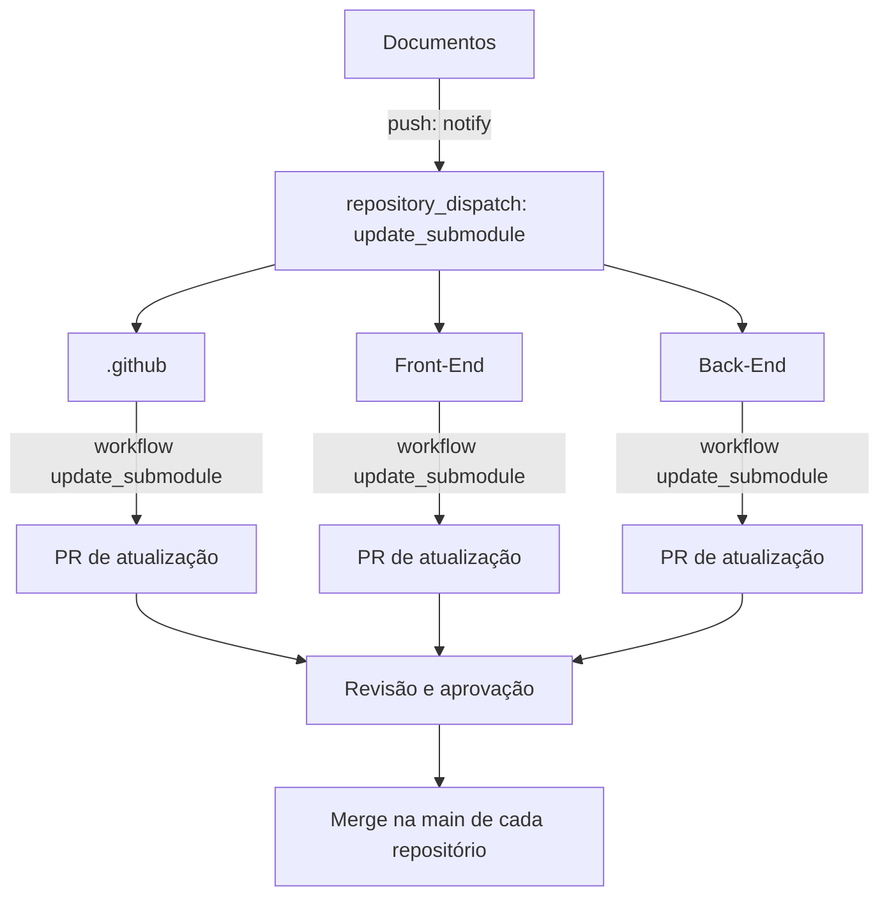
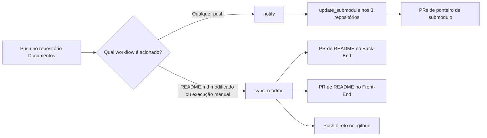
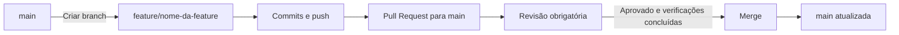

# Arquitetura de Repositórios e Fluxo de Desenvolvimento — Janosys-Log

> **Tipo de arquitetura:** multirepo na organização GitHub, com Maven Multi-Module no back-end.  
> **Estratégia de branches:** GitHub Flow.  
> **Política de integração:** alterações na `main` por Pull Request (PR) revisado e aprovado.

## 1. Objetivo

Este documento descreve a organização dos repositórios, a responsabilidade de cada projeto, a estrutura lógica das aplicações e os processos de desenvolvimento, revisão e sincronização de documentação da organização **Janosys-Log**.

As descrições dos workflows refletem os arquivos YAML fornecidos. Onde um comportamento não está definido pelos arquivos, ele aparece explicitamente como **diretriz recomendada**, e não como funcionalidade já implementada.

## 2. Organização dos repositórios

Todos os projetos pertencem à mesma organização GitHub, mas cada repositório possui histórico, branches, Pull Requests e configurações próprias.

```text
Janosys-Log/
├── .github/       # Perfil e configurações comunitárias da organização
├── Documentos/    # Documentação central e README de referência
├── Front-End/     # Interface web React + Vite
└── Back-End/      # Java + Spring Boot, com módulos e microserviços
```

| Repositório  | Responsabilidade principal                                               | Workflows informados    |
| ------------ | ------------------------------------------------------------------------ | ----------------------- |
| `.github`    | Perfil público da organização e arquivos de configuração organizacional  | `update_submodule`      |
| `Documentos` | Fonte central da documentação compartilhada e do README                  | `notify`, `sync_readme` |
| `Front-End`  | Aplicação web desenvolvida com React e Vite                              | `update_submodule`      |
| `Back-End`   | Serviços de backend Java/Spring Boot, organizados com Maven Multi-Module | `update_submodule`      |

> **Convenção de nomes:** os exemplos de caminhos mantêm a capitalização presente nos workflows: `Janosys-Log/Documentos`, `Janosys-Log/Front-End` e `Janosys-Log/Back-End`. O diretório do submódulo nos consumidores é `Documentos`.

## 3. Arquitetura das aplicações

### 3.1 Front-End

O repositório `Front-End` contém a aplicação de interface:

- **Biblioteca de UI:** React.
- **Ferramenta de desenvolvimento e build:** Vite.
- **Ciclo de vida:** alterações, testes, builds e publicações próprios, independentes do repositório `Back-End`.
- **Integração com o back-end:** via contratos de API definidos pela aplicação (endpoints e protocolos específicos não foram informados).

Estrutura **ilustrativa**, não necessariamente a estrutura já existente:

```text
Front-End/
├── .github/workflows/
│   └── update_submodule.yaml
├── Documentos/             # Submódulo Git de documentação
├── public/
├── src/
├── index.html
├── package.json
└── vite.config.ts           # Exemplo: variante TypeScript
```

### 3.2 Back-End: Maven Multi-Module e microserviços

O repositório `Back-End` agrupa os microserviços Spring Boot, enquanto o **Maven Multi-Module** organiza a compilação e o gerenciamento de dependências internas. O fato de módulos compartilharem um repositório ou POM agregador **não os transforma em uma única aplicação**.

Estrutura **proposta com base na arquitetura discutida**, com nomes de serviços meramente exemplificativos:

```text
Back-End/
├── .github/workflows/
│   └── update_submodule.yaml
├── Documentos/                  # Submódulo Git de documentação
├── pom.xml                      # POM agregador
├── mvnw
├── .mvn/
├── services/
│   ├── auth-service/
│   │   ├── pom.xml
│   │   └── src/
│   ├── user-service/
│   │   ├── pom.xml
│   │   └── src/
│   ├── product-service/
│   │   ├── pom.xml
│   │   └── src/
│   └── order-service/
│       ├── pom.xml
│       └── src/
├── libraries/
│   ├── common-exceptions/
│   └── common-security/
└── infrastructure/
    └── compose.yaml
```

**Princípios de separação:**

1. Cada microserviço deve representar uma responsabilidade funcional bem delimitada.
2. Cada microserviço deve possuir ponto de entrada Spring Boot e configurações próprias.
3. Cada microserviço deve poder ser testado, empacotado e implantado independentemente, conforme a infraestrutura adotada.
4. Bibliotecas em `libraries/` podem compartilhar funcionalidades técnicas genéricas, mas não devem acoplar implementações internas de serviços diferentes.
5. Recomenda-se que cada serviço controle seus próprios dados, evitando acesso direto às tabelas ou repositories de outro serviço.
6. Comunicação entre serviços deve ocorrer por contratos explícitos, como APIs HTTP ou eventos, a serem escolhidos conforme o projeto.

**Comandos Maven de referência** (a partir da raiz do `Back-End`, para módulos com essa estrutura):

```bash
# Compilar e testar todos os módulos
./mvnw clean verify

# Empacotar um serviço e construir módulos internos necessários
./mvnw -pl services/user-service -am package

# Executar um serviço Spring Boot (dependências internas já disponíveis)
./mvnw -pl services/user-service spring-boot:run
```

> A estrutura, os nomes dos microserviços e os comandos desta subseção são uma **proposta arquitetural**. Não foram fornecidos o `pom.xml`, o código-fonte nem as configurações de deploy reais.

## 4. Documentação centralizada e submódulos Git

O repositório `Documentos` atua como origem compartilhada da documentação. Os repositórios `.github`, `Front-End` e `Back-End` possuem um workflow `update_submodule` que atualiza sua referência local ao submódulo Git no caminho `Documentos`.



Um **submódulo Git** é uma referência a um commit específico de outro repositório. Atualizar o submódulo no consumidor altera essa referência, sem copiar toda a documentação para o histórico do repositório consumidor como arquivos comuns.

### 4.1 Workflow `notify` — repositório `Documentos`

**Objetivo:** toda atualização no repositório `Documentos` deve acionar um gatilho nos demais repositórios, para que cada um atualize seu submódulo, assim nenhum repositório terá um histórico de documentação atrasada

**Gatilhos observados:** `push` (sem filtro de branch ou caminhos no arquivo fornecido) e `workflow_dispatch`.

**Comportamento atual:**

1. Inicia o job `notify`.
2. Usa uma matriz com os destinatários `Janosys-Log/Back-End`, `Janosys-Log/Front-End` e `Janosys-Log/.github`.
3. Executa `peter-evans/repository-dispatch@v4.0.1` para cada destinatário.
4. Envia o evento GitHub `repository_dispatch` com o tipo `update_submodule`.
5. Autentica as solicitações com o secret `PAT_DISPATCH`.

**Resultado esperado:** os três repositórios destinatários recebem a solicitação de atualização de seus submódulos, desde que o token, as permissões e a configuração de eventos estejam corretos.

### 4.2 Workflow `update_submodule` — repositórios consumidores

**Objetivo:** recebe o gatilho enviado pelo `Documentos`.`notify` e atualiza automaticamente o repositório, respeitando a criação de PRs para merge de outras branchs

**Gatilho observado:** evento `repository_dispatch`, filtrado para o tipo `update_submodule`.

**Comportamento atual:**

1. Faz checkout do próprio repositório com `actions/checkout@v6`, incluindo submódulos.
2. Executa `git submodule update --remote`.
3. Adiciona o caminho `Documentos` ao staging.
4. Usa `peter-evans/create-pull-request@v8` para criar ou atualizar um PR de `update/submodule` para `main`, caso exista alteração elegível.
5. Configura a exclusão da branch automatizada após a conclusão do PR.

O workflow declara `contents: write` e `pull-requests: write` e usa o secret `PAT_DISPATCH` para operações autenticadas.

### 4.3 Workflow `sync_readme` — repositório `Documentos`

**Objetivo:** Toda atualização do README principal(Documentos) deve ser alterar os READMES dos demais repositórios, assim nenhum repositório terá um README desatualizado

**Gatilhos observados:** alteração em `README.md` por `push`, sem filtro de branch no arquivo, ou execução manual por `workflow_dispatch`.

O README da origem é distribuído de modo diferente a cada destino:

| Destino     | Arquivo de destino  | Operação observada                                                         |
| ----------- | ------------------- | -------------------------------------------------------------------------- |
| `Back-End`  | `README.md` na raiz | Clone, cópia do arquivo e criação/atualização de PR para `main`            |
| `Front-End` | `README.md` na raiz | Clone, cópia do arquivo e criação/atualização de PR para `main`            |
| `.github`   | `profile/README.md` | Clone, cópia, commit e `git push` diretamente na branch atualmente checada |

Para `Back-End`, o PR utiliza a branch `update/back-End`; para `Front-End`, `update/readme-frontend`. A automação usa `PAT_COPY` para operações de escrita.

**Observação importante:** a atualização do README é uma **cópia sincronizada**; já o submódulo `Documentos` é uma **referência Git**. São duas integrações distintas e coexistentes.

## 5. Relação entre os workflows

As atualizações de documentação dão origem a dois fluxos de sincronização:



**Exemplo de atualização da documentação:**

1. Uma alteração é desenvolvida em branch no repositório `Documentos`.
2. O PR é revisado, aprovado e integrado à `main`.
3. O `push` resultante dispara `notify`.
4. `notify` envia `repository_dispatch` aos três repositórios consumidores.
5. Cada consumidor executa `update_submodule` e pode abrir um PR atualizando a referência de `Documentos`.
6. Se `README.md` estiver entre os caminhos modificados no push, `sync_readme` também é acionado e pode abrir PRs de atualização de README em `Back-End` e `Front-End`.
7. Os PRs automatizados passam pelo mesmo processo de revisão e aprovação das demais alterações.

> Como `notify` não filtra a branch, pushes em branches de trabalho de `Documentos` também podem disparar a notificação. O fluxo de exemplo acima assume a integração pela `main`, mas o arquivo atual não restringe o gatilho a ela.

## 6. Estratégia de branches — GitHub Flow Personalizada

A organização utiliza **GitHub Flow Personalizado**: uma branch de produção estável (`main`), uma branch de desenvolvimento e testes (`staged`), branches curtas de trabalho e integração por Pull Request.



### 6.1 Convenções de branches

| Prefixo     | Finalidade                    | Exemplo                 |
| ----------- | ----------------------------- | ----------------------- |
| `feature/`  | Nova funcionalidade           | `feature/login`         |
| `fix/`      | Correção de erro              | `fix/token-expirado`    |
| `docs/`     | Documentação                  | `docs/arquitetura`      |
| `refactor/` | Refatoração                   | `refactor/user-service` |
| `chore/`    | Manutenção                    | `chore/dependencias`    |
| `update/`   | Automatizações e atualizações | `update/submodule`      |

Esses prefixos são convenções propostas; não são regras verificadas nos repositórios.

### 6.2 Política obrigatória de Pull Request

**Nenhuma feature deve ser integrada diretamente à `main`.** O procedimento exigido pela organização é:

1. Criar uma branch de trabalho a partir da `staged` atualizada.
2. Desenvolver a alteração e publicar os commits na branch.
3. Abrir Pull Request com destino à `staged`.
4. Designar ao menos um revisor responsável.
5. Obter revisão e aprovação antes do merge.
6. Resolver apontamentos e conflitos antes da integração.
7. Realizar o merge apenas após a aprovação.
8. Excluir a branch de trabalho após o merge, quando não for mais necessária.
9. Ao final da sprint, após todas as features serem testadas e aprovadas, será aberto um Pull Request com destino à `main`
10. Esse Pull Request deve também passar por aprovação

**Aplicação da mesma política às automações:** PRs criados por `update_submodule` e `sync_readme` também precisam passar por revisão antes de integrar a `staged`.

### 6.3 Proteções de branch

Para efetivar as regras no GitHub, existe uma ruleset ou proteção da `main` em **cada um dos quatro repositórios**, com:

- Obrigatoriedade de Pull Request antes de merge.
- Mínimo de **1 aprovação** por revisor autorizado.
- Bloqueio de push direto para `main`, inclusive para automações que não tenham exceção explicitamente autorizada.
- Bloqueio de merge com conversas de revisão pendentes.
- Verificações de CI obrigatórias, quando configuradas.
- Restrição ou proibição de bypass para assegurar o processo de revisão.
